# SPICE simulation report: moon reading light

Main board v0.1 + LED board v0.2, as in `hardware/*/design.py`. Generated 2026-11-08 by `python3 sim/run_sims.py` (ngspice-42, 33 runs over 10 circuits plus a model check). **These are predictions, not evidence**: every value nobody has measured is listed under *Assumptions* with the VERIFY item that replaces it.

## Summary

**19 pass, 5 marginal, 4 fail, 7 for information** (35 checks against datasheet limits and the pass criteria in `docs/verification/VERIFY.md`). The FAIL rows are two issues: the USB-unplug dip (as built, plus the two R5 values tried as remedies) and the J3 hot-plug at a low battery.

What needs a decision:

1. **USB unplug dips VSYS by 0.64 V for about 21 ms** (VERIFY E12 allows 0.3 V). Q1's body diode carries the lamp until R5 has pulled VBUS down far enough to turn Q1's channel on. The MCU stays up (minimum 2.89 V against the 2.6 V BOD), but the LED-board current drops from 185 mA to about 130 mA for that time, which may show as a blink. E12's own remedy (R5 4.7k) only shortens it (10 ms; 2.5 ms with 1k): the depth is the body diode's drop and no R5 value changes it. Options: accept and re-word E12 to "no reset"; R5 1k (costs 5 mA from USB while plugged in); or drive Q1's gate actively in the next revision.
2. **Hot-plugging the LED-board cable resets the MCU at a low battery** (VSYS falls to 2.30 V at 3.49 V; 2.74 V on a full cell, just above the 2.6 V BOD). The cable is inside the gooseneck, so this is a bench situation, but VERIFY E13 asks for it. E13's remedy (47 µF on VSYS) brings the low-battery case to 2.72 V and raises the power-on inrush from 0.64 A to 1.69 A. Simplest: drop the hot-plug step from E13 (plug J3 with the switch off).
3. **On a weak USB source VSYS falls below E15's 3.9 V**: 3.71 V at 4.75 V USB through a 0.2 Ω cable with F1 at its 0.2 Ω maximum (about 3.80 V without the cable). Q1's body diode then sees 0.47 V forward and leaks 0.5 mA from the cell, too little to upset the charge termination. At 5.0 V VSYS is 4.00 V. E15 should name the source voltage (5.0 V nominal).

What the simulation confirms:

- Q4's soft turn-on works as designed: VLED ramps 10-90 % in 1.1 ms at 2.7 V/ms, and VSYS moves by 10 mV.
- Power-on through Q2 draws 0.64 A peak from a full cell (0.49 A at 3.49 V), with no overshoot on VSYS.
- Plugging USB in peaks at 5.77 V on VBUS and 4.78 V on VSYS (abs max 7 V / 6 V), even with a short, low-resistance cable.
- Load sharing (R18): with the lamp on, the cell still charges at 256 mA and tapers to the 31 mA termination after 5.1 h; USB draw peaks at 0.45 A.
- Battery life to the firmware's empty cut: 6.7 h at 4000 K full, 42 h at soft white level 10, 118 h in red night light (94-158 h for 12-7 mA of electronics). Close to the estimates in `docs/design/electronics.md` §3 (6.5 h, 45 h, 100-150 h).
- The whites stay regulated down to VSYS 3.10 V (typical dies) and 3.40 V (max-VF dies with the worst VSAT), below the 3.45 V low-battery cap. Green/blue need 3.57 V (typical) and 4.12 V (max die) at the board, matching the round-3 figures.

## All checks

| ID | Area | Check | Simulated | Limit | Verdict |
|---|---|---|---|---|---|
| P1-full | Power-on (SW1) | Cell inrush peak, cell 4.18 V | 0.64 A | < ~3 A (typical DW01-class PCM over-current trip, PROVISIONAL); Q2 IDM 15 A | **PASS** |
| P1-low | Power-on (SW1) | Cell inrush peak, cell 3.49 V | 0.49 A | < ~3 A (typical DW01-class PCM over-current trip, PROVISIONAL); Q2 IDM 15 A | **PASS** |
| P1-full_bulk47 | Power-on (SW1) | Cell inrush peak, cell 4.18 V, + 47 uF on VSYS | 1.69 A | < ~3 A (typical DW01-class PCM over-current trip, PROVISIONAL); Q2 IDM 15 A | **PASS** |
| P2 | Power-on (SW1) | VSYS rise 10-90 % and overshoot | 76 us, overshoot 0 mV | monotonic, no overshoot | **PASS** |
| Q1 | Q4 soft turn-on | VLED ramp at the LED board (10-90 %), cell 3.49 V | 1.06 ms, 2.66 V/ms max | ramps over ~1-2 ms (E13); 2.5 V/ms design | **PASS** |
| Q2 | Q4 soft turn-on | VSYS dip, worst of 4 corners | 12 mV | <= 200 mV (E13) | **PASS** |
| Q3 | Q4 soft turn-on | Peak LED-board charging current, worst corner | 36 mA | design note says 15-25 mA | **INFO** |
| J1-full | J3 hot-plug | VSYS minimum, cell 4.18 V | 2.74 V | > 2.6 V (ATtiny BOD level, fuses: bod = 2.6v) | **MARGINAL** |
| J1-low | J3 hot-plug | VSYS minimum, cell 3.49 V | 2.30 V | > 2.6 V (ATtiny BOD level, fuses: bod = 2.6v) | **FAIL** |
| J1-low_bulk47 | J3 hot-plug | VSYS minimum, cell 3.49 V, + 47 uF on VSYS | 2.72 V | > 2.6 V (ATtiny BOD level, fuses: bod = 2.6v) | **MARGINAL** |
| J2 | J3 hot-plug | Peak cable current / LED-board peak voltage | 19.1 A / 4.18 V | LED board <= 6 V abs max (LP5012, MCP9800) | **PASS** |
| U1-r01 | USB plug-in | VBUS peak, 5.25 V, cable 0.1 Ohm | 5.77 V | < 7.0 V (MCP73831 abs max); TVS VBR 6.4 V min | **PASS** |
| U2-r01 | USB plug-in | VSYS / LED-board peak, 5.25 V, cable 0.1 Ohm | 4.78 / 4.76 V | < 6.0 V (ATtiny3216, LP5012 abs max) | **PASS** |
| U1-r03 | USB plug-in | VBUS peak, 5.25 V, cable 0.3 Ohm | 5.06 V | < 7.0 V (MCP73831 abs max); TVS VBR 6.4 V min | **PASS** |
| U2-r03 | USB plug-in | VSYS / LED-board peak, 5.25 V, cable 0.3 Ohm | 4.20 / 4.18 V | < 6.0 V (ATtiny3216, LP5012 abs max) | **PASS** |
| U3 | USB plug-in | Attach inrush peak from the charger | 10.1 A | USB 2.0: <= 10 uF at attach without inrush limiting | **INFO** |
| H1-r5_10k | USB unplug | VSYS dip below battery level, R5 10k (as built) | 0.64 V for 21 ms (>0.3 V); min 2.89 V | <= 0.3 V, no reset (E12); BOD 2.6 V | **FAIL** |
| H1-r5_4k7 | USB unplug | VSYS dip below battery level, R5 4.7k (E12 remedy) | 0.64 V for 10 ms (>0.3 V); min 2.89 V | <= 0.3 V, no reset (E12); BOD 2.6 V | **FAIL** |
| H1-r5_1k | USB unplug | VSYS dip below battery level, R5 1k | 0.64 V for 3 ms (>0.3 V); min 2.89 V | <= 0.3 V, no reset (E12); BOD 2.6 V | **FAIL** |
| H2 | USB unplug | LED current during the handover (4000 K full) | 185 mA -> 90 mA | no visible step (no spec) | **INFO** |
| C1 | Charge + load share | Charger terminates with the lamp on (R18) | I_bat falls to 31 mA at 5.09 h; Q1 body diode max 0.19 V forward | termination reached; Q1 body diode < 0.4 V (not conducting) | **PASS** |
| C2 | Charge + load share | Same, weak USB (4.75 V, PTC 0.2 Ohm cold max, cable 0.2 Ohm) | Q1 body diode 0.47 V forward, 0.46 mA from the cell into VSYS; terminates at 5.09 h | body-diode current < 3.1 mA (10 % of the 31 mA termination) | **PASS** |
| C3 | Charge + load share | Peak USB current, charging + 4000 K full | 0.447 A | <= ~0.8 A (F1 hold at 60 C); E11 expects 0.5-0.6 A | **PASS** |
| C4 | Charge + load share | VSYS on USB (minimum over the charge) | 4.00 V (5.0 V USB); 3.71 V (4.75 V, PTC 0.2 Ohm) (both with a 0.2 Ohm cable) | >= 3.9 V (E15) | **MARGINAL** |
| C5 | Charge + load share | MCP73831 dissipation, peak | 0.46 W | <= 0.69 W design worst case (thermal regulation above) | **PASS** |
| R1-4000k | Runtime | Battery life, 4000 K full | 6.7 h to the empty cut (4.45 Wh delivered; brightness cap after 6.0 h) | estimate 6.5 h (electronics.md 3) | **INFO** |
| R1-soft10 | Runtime | Battery life, soft white level 10 | 42.0 h to the empty cut (4.50 Wh delivered; brightness cap after 40.1 h) | estimate 45 h (electronics.md 3) | **INFO** |
| R1-night | Runtime | Battery life, red night level 4 | 118.2 h to the empty cut (4.51 Wh delivered; brightness cap after 115.1 h) | estimate 100-150 h (electronics.md 3) | **INFO** |
| D1 | LED headroom | Whites stay regulated down to the low-battery cut (8 on together) | 95 % point at VSYS 3.10 V / cell OCV 3.17 V (typ); VSYS 3.40 V / OCV 3.47 V (max-VF dies, VSAT 0.45 V) | VSYS edge < 3.45 V (VBAT_LOW is measured on VSYS under load) | **MARGINAL** |
| D2 | LED headroom | Green/blue regulation edge (VLED at the board) | typ die 3.57 V; max-VF die 4.12 V | design: ~3.65 V typ, ~4.05-4.15 V max die (round3 R3-E3) | **INFO** |
| W1-d50 | PWM ripple | Ripple, all whites in phase, 50 % duty | VLED 81 mV p-p (min 3.65 V); VSYS 59 mV p-p | LP5012 VCC >= 2.7 V; VSYS > 2.6 V | **PASS** |
| W1-d89 | PWM ripple | Ripple, all whites in phase, 88.75 % duty (4000 K full) | VLED 48 mV p-p (min 3.64 V); VSYS 30 mV p-p | LP5012 VCC >= 2.7 V; VSYS > 2.6 V | **PASS** |
| I1-c60 | I2C | Rise time 30-70 %, 60 pF | 168 ns | <= 1000 ns (standard mode, 100 kHz) | **PASS** |
| I1-c100 | I2C | Rise time 30-70 %, 100 pF | 280 ns | <= 1000 ns (standard mode, 100 kHz) | **PASS** |
| I1-c150 | I2C | Rise time 30-70 %, 150 pF | 419 ns | <= 1000 ns (standard mode, 100 kHz) | **MARGINAL** |

MARGINAL means inside the limit with less margin than this report's own rule of thumb (stated per check in `sim/run_sims.py`). INFO rows have no hard limit.

## The circuits as simulated

SPICE subcircuits in `sim/boards.inc` follow the reference designators of the two boards. Device models are in `sim/models.inc`; each is fitted to datasheet points (checked in the *Model check* table below).

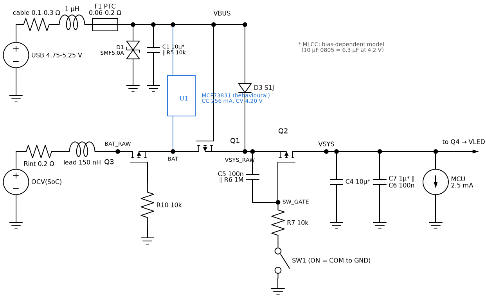

*Main-board power path: cell model, reverse-battery FET Q3, load-share FET Q1 (gate on VBUS), D3 from USB, the slide-switch FET Q2 with its R7/C5 soft start, and the VSYS loads. The charger is a behavioural CC/CV source.*

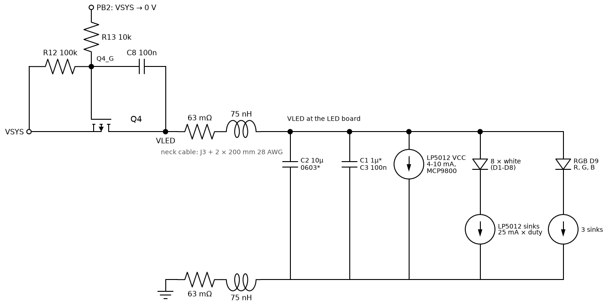

*Q4 with its Miller soft start (R13 into C8), the neck cable (both conductors), and the LED board: bulk and bypass MLCCs, LP5012 supply current, and the LED channels as LED + LP5012 sink.*

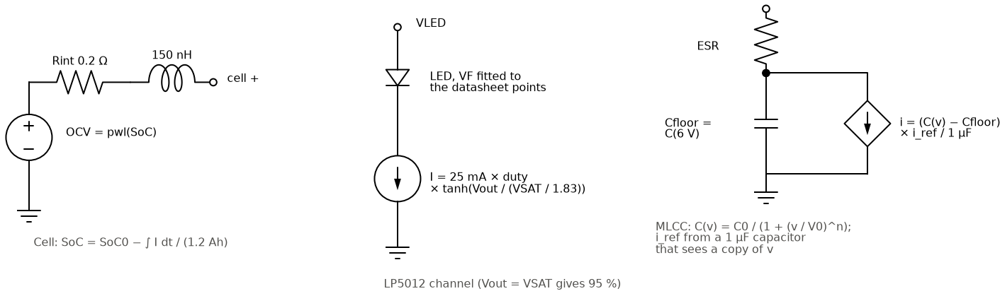

*Behavioural models: the cell (open-circuit voltage from the state of charge), one LP5012 channel, and the bias-dependent MLCC.*

## 1. Power-on inrush (slide switch, Q2)

SW1 pulls Q2's gate down through R7 10k; C5 (100 nF) sits gate-to-source, so the gate voltage falls with a 1 ms time constant and Q2 turns on hard once it passes its threshold. The VSYS capacitors (C4 10 µF, C7 1 µF, C6 100 nF; about 7 µF at 4 V) then charge through the cell, Q3, Q1 and Q2.

Peak cell current 0.64 A (full cell) and 0.49 A (3.49 V); VSYS rises 10-90 % in 76 µs with no overshoot. Round 1 had predicted 0.7-1.3 A into 14-21 µF; the LED board now sits behind Q4, so Q2 sees less capacitance. With 47 µF added on VSYS (the E13 remedy) the peak rises to 1.69 A, still well below the FET's 15 A pulse rating but closer to the cell PCM's over-current trip (typically ~3 A on DW01-class protectors; not documented for this cell).

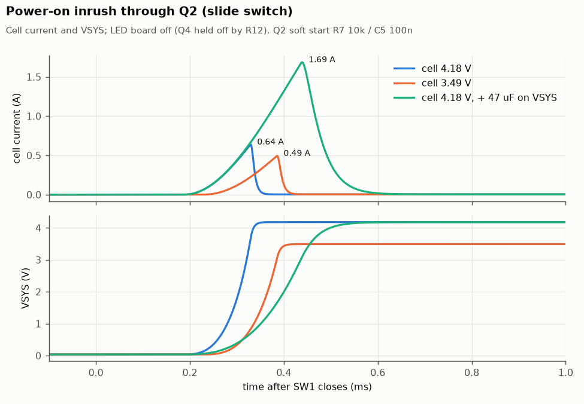

## 2. Q4 soft turn-on of the LED board

PB2 drives Q4's gate through R13 10k with C8 100 nF from gate to drain: the Miller plateau holds the gate while C8 charges, so VLED rises at about (VSYS − |VGS(plateau)|) / (R13 · C8). The LED board is in standby (LEDs off), so it loads VLED with its MLCCs only. Four corners: cell 3.49 V / 4.18 V and Q4 threshold −0.5 / −0.9 V.

At 3.49 V (the E13 condition) VLED takes 1.06 ms from 10 to 90 %, peak 2.66 V/ms, and the charging current peaks at 29 mA (36 mA worst corner). VSYS moves by 10 mV. The current is higher than the design note's 15-25 mA because the MLCCs start at their unbiased value (about 11 µF at 0 V, falling to about 4.5 µF at 3.5 V); it is still harmless.

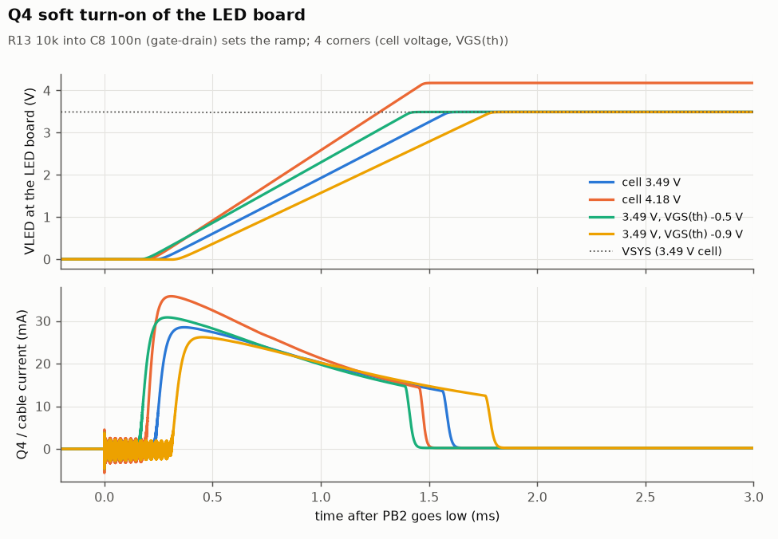

## 3. Hot-plugging the LED-board cable

With Q4 on, plugging the cable connects the LED board's empty MLCCs straight to VSYS. The main board has no bulk capacitance on VLED, so C4 shares its charge with them within about 2 µs; the cell, behind its resistance and lead inductance, brings VSYS back over the next ~50 µs.

The cable current peaks at 19 A in a pulse about 1.5 µs wide. VSYS falls to 2.74 V on a full cell and to 2.30 V at 3.49 V, below the ATtiny's 2.6 V BOD level, so expect a reset. With 47 µF on VSYS the 3.49 V case bottoms at 2.72 V. The BOD's response time to a dip of a few microseconds is not modelled; a short dip may not trip it, so treat this as the worst case. The LED board never exceeds VSYS (no overshoot).

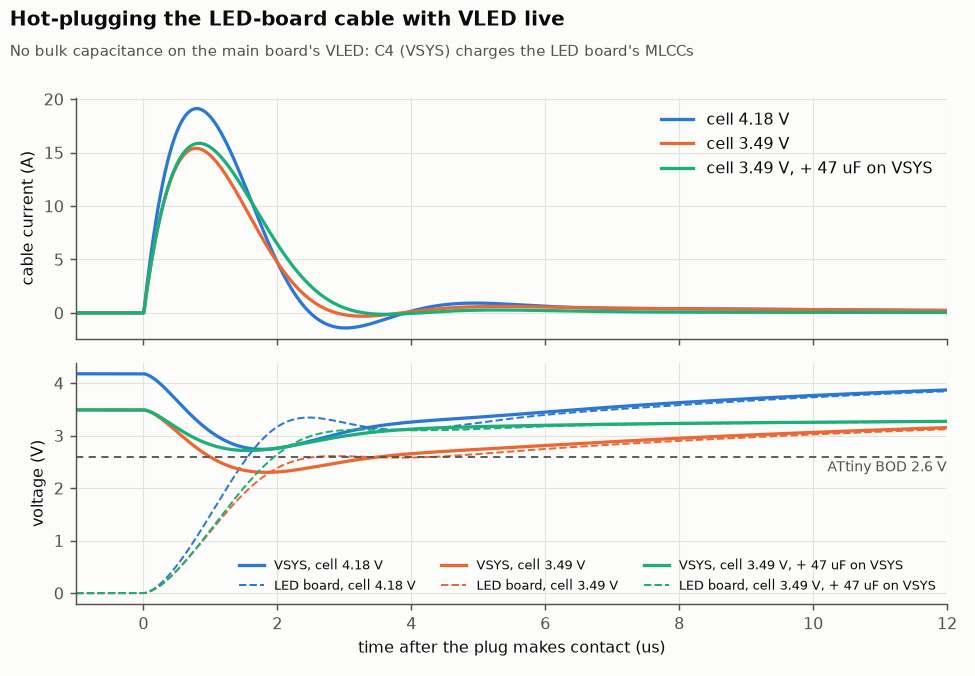

## 4. Plugging in USB while the lamp runs

A 5.25 V source (top of the USB tolerance) through a 1 µH cable is connected while the lamp runs at 4000 K from a 3.74 V cell. The cable rings with C1, and D3 also charges VSYS_RAW/VSYS up from the battery level.

With a 0.1 Ω cable, VBUS peaks at 5.77 V (MCP73831 abs max 7 V; the TVS does not conduct) and VSYS at 4.78 V (ATtiny and LP5012 abs max 6 V). With 0.3 Ω the peaks are 5.06 V / 4.20 V. The charger supplies a 10 A peak for a few microseconds; USB 2.0 asks a device to present no more than 10 µF at attach, and C1 is 10 µF nominal, but D3 adds C3/C4 while VSYS_RAW sits below VBUS − 0.85 V. Most chargers ride through it; no action proposed.

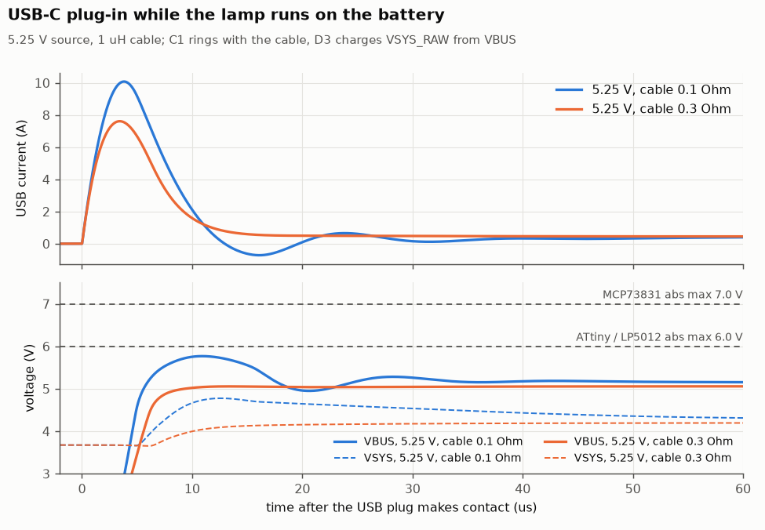

## 5. Unplugging USB (handover to the battery)

On USB, VSYS comes through D3 and Q1 is held off because its gate sits on VBUS. When USB is pulled, the lamp first drains C1 through D3, then Q1's body diode takes the load (cell → VSYS_RAW, about 0.65 V drop). Q1's channel turns on only when R5 has discharged VBUS below VSYS_RAW − |VGS(th)|. Cell 3.6 V, lamp 4000 K full (the E12 condition).

VSYS falls from 3.99 V to 2.89 V, 0.64 V below the 3.53 V it settles at on the battery, for 21 ms with R5 10k. R5 4.7k and 1k shorten this to 10 ms and 2.5 ms but do not reduce the depth. The MCU stays above its BOD; the whites lose headroom and the LED-board current drops by about 30 % for that time.

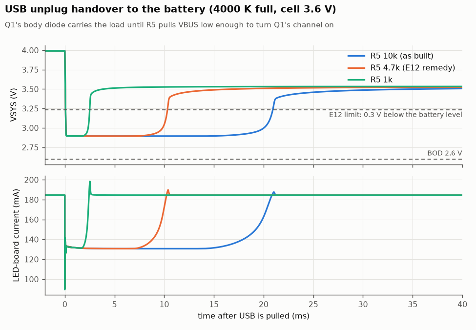

## 6. Charging with the lamp on (load sharing)

A full charge from an empty cell (3.0 V) on a 5.0 V source, with the lamp at 4000 K full for the whole charge, with it off, and on a weak source (4.75 V, PTC at its 0.2 Ω maximum); all through a 0.2 Ω USB cable. The MCP73831 model is CC 256 mA / CV 4.20 V; the 31 mA termination point is read off the cell current.

The cell current is the same with and without the lamp: the lamp is fed from D3, so the charger sees only the cell and reaches its 31 mA termination after 5.1 h either way (R18). Peak USB current 0.45 A (lamp on) and 0.26 A (off); charger dissipation peaks at 0.46 W. VSYS stays at 4.00 V or more on the 5.0 V source but drops to 3.71 V on the weak one.

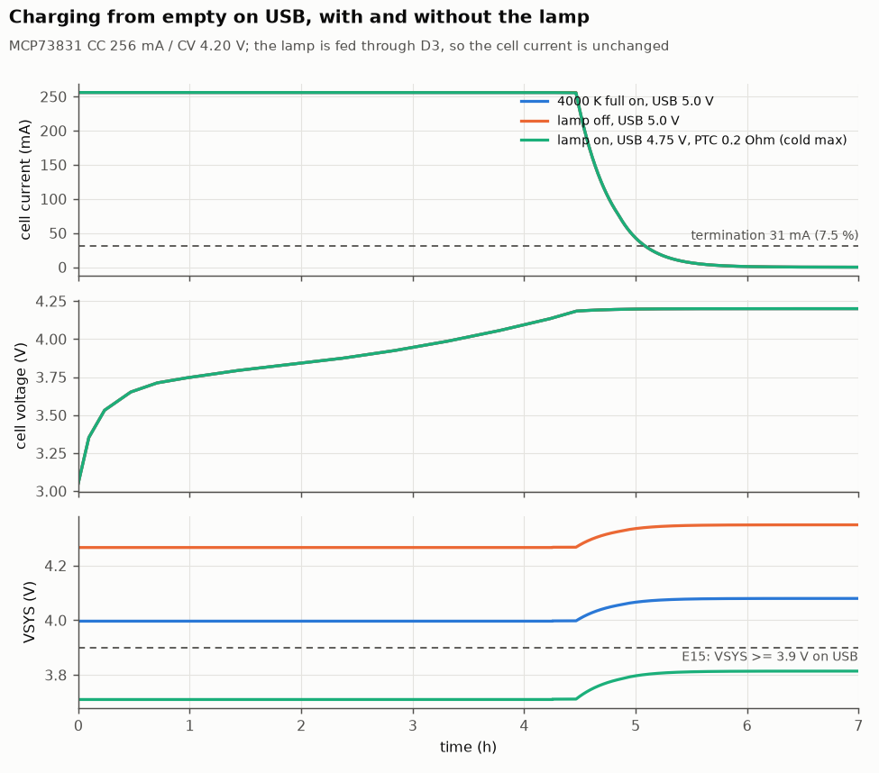

## 7. Battery life per mode

Discharge from full at a fixed mode until VSYS (which the firmware measures under load) falls to 3.30 V. Below 3.45 V the firmware caps brightness to 35 %, modelled as a latch. LED drive is the average PWM duty on the LP5012 sinks; electronics are MCU 2.5 mA + LP5012 6.8 mA + MCP9800 0.2 mA. Thermal derating is not modelled, so the 4000 K figure is an upper bound once the head warms.

4000 K full: 6.7 h (brightness cap after 6.0 h; estimate 6.5 h). Soft white level 10: 42 h (estimate 45 h). Red night level 4: 118 h (estimate 100-150 h; 94-158 h for 12-7 mA of electronics, which dominate at this level). Every mode delivers about 4.45 Wh before the cut.

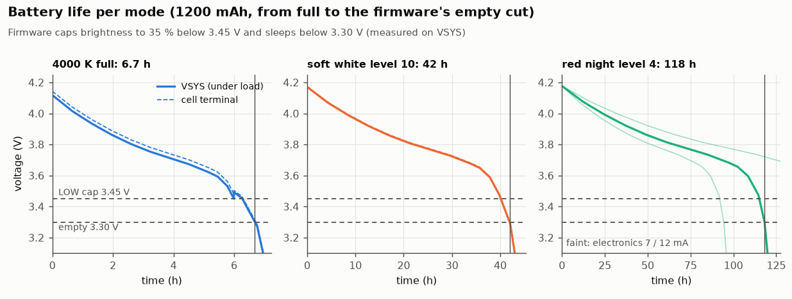

## 8. LED channel headroom

DC sweep of the cell's open-circuit voltage with 0.2 Ω cell resistance and the full path (Q3, Q1, Q2, Q4, cable). Left: all eight whites on at once, the instantaneous peak of 4000 K full (200 mA). Right: the Green mode. Typical dies with VSAT 0.30 V, and maximum-VF dies with VSAT 0.45 V (VSAT at 25 mA is not specified).

The whites hold 95 % of 25 mA down to VSYS 3.10 V (typical) and 3.40 V (worst case), so they are regulated wherever the firmware runs at full brightness. Green needs VLED 3.57 V at the board with a typical die (design note: ~3.65 V) and 4.12 V with a maximum-VF die (design note: 4.05-4.15 V). A worst-case die reaches only 15 mA at a 3.7 V cell. VERIFY E9 measures the received dies.

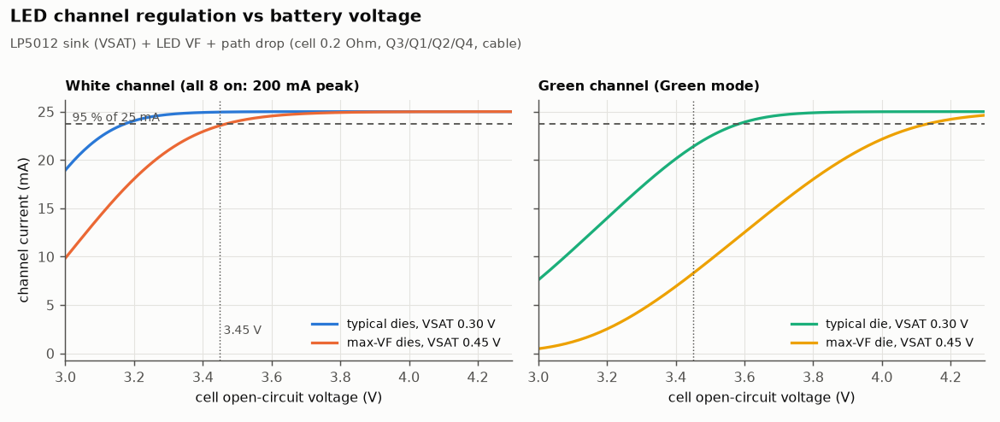

## 9. PWM ripple at 29 kHz

All eight whites switching together at the LP5012's 29 kHz, which is the worst case: the datasheet extract does not say whether the LP5012 staggers its outputs. 50 % duty gives the largest ripple; 88.75 % is 4000 K full.

At 50 % duty, VLED at the LP5012 swings 81 mV p-p (minimum 3.65 V) and VSYS 59 mV p-p. Far from the LP5012's 2.7 V minimum and the MCU's BOD; the ATtiny's ADC reading of VDD will see this ripple, which the firmware averages.

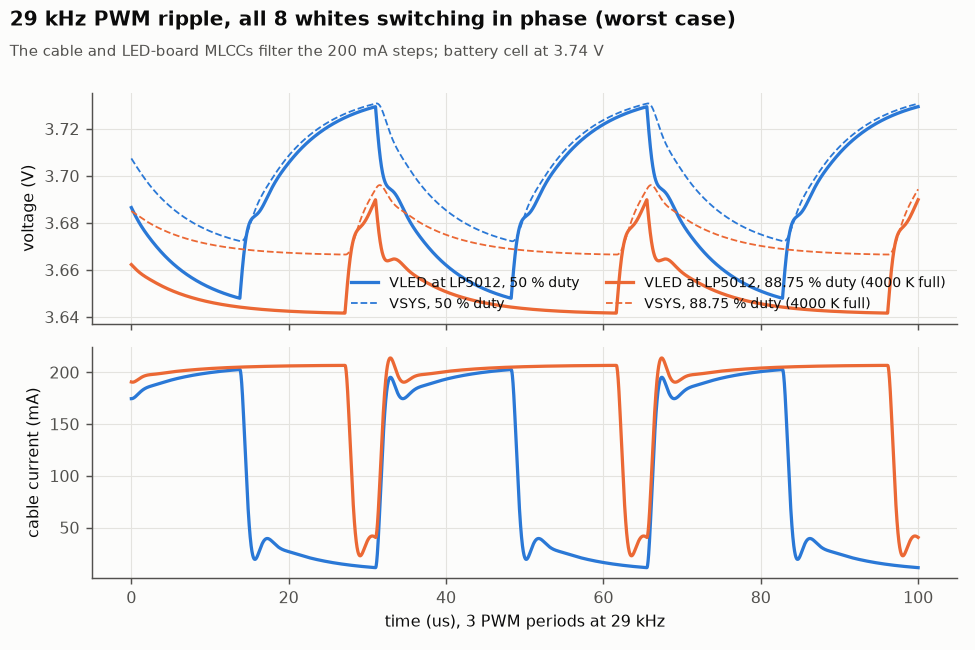

## 10. I²C rise time

R8/R9 3.3 kΩ to VLED against the bus capacitance (MCU pin, 200 mm cable, LP5012, MCP9800): 60-100 pF estimated, 150 pF as margin.

Rise time (30-70 %): 168 / 280 / 419 ns for 60 / 100 / 150 pF, against 1000 ns for standard mode, where the firmware runs the bus (100 kHz). Fast mode (400 kHz, 300 ns) would pass at 60 pF only, so the bus should stay at 100 kHz.

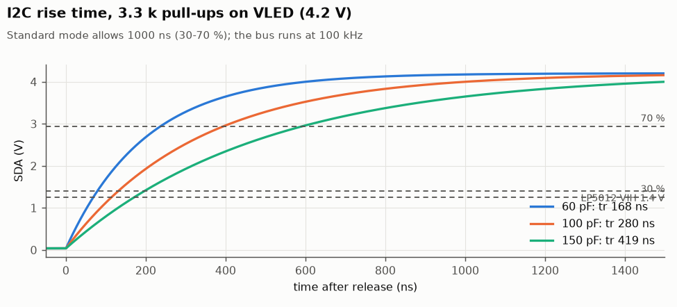

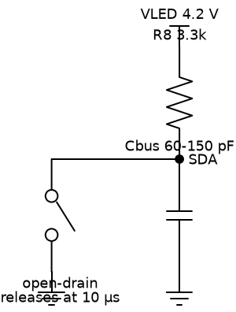

*I²C test circuit: an open-drain pin releases SDA at 10 µs.*

## Model check

Each device model at the operating points it was fitted to (`sim/cases/model_check.cir`).

| Quantity | Model | Datasheet / design | Source |
|---|---|---|---|
| DMG2305UX R_DS(on) @ VGS -4.5 V (Ohm) | 0.040 | 0.040 typ / 0.052 max | KEYSPECS |
| DMG2305UX R_DS(on) @ VGS -2.5 V (Ohm) | 0.084 | 0.052 typ / 0.100 max | KEYSPECS |
| DMG2305UX body diode @ 0.1 A (V) | 0.653 | ~0.65 (PROVISIONAL) | typical silicon |
| Thrive 2835 white VF @ 10 mA (V) | 2.701 | ~2.70 | DS312 Fig. 9 |
| Thrive 2835 white VF @ 25 mA (V) | 2.775 | ~2.75 | DS312 Fig. 9 |
| Thrive 2835 white VF @ 50 mA (V) | 2.851 | ~2.85 | DS312 Fig. 9 |
| Thrive white max-VF die @ 25 mA (V) | 2.925 | ~2.92 | electronics.md 2 |
| Wurth red VF @ 20 mA (V) | 2.001 | 2.0 typ | Wurth p2 |
| Wurth red max die @ 20 mA (V) | 2.401 | 2.4 max | Wurth p2 |
| Wurth green/blue VF @ 20 mA (V) | 3.201 | 3.2 typ | Wurth p2 |
| Wurth green/blue max die @ 20 mA (V) | 3.602 | 3.6 max | Wurth p2 |
| Wurth G/B VF rise 20 -> 25 mA (V) | 0.090 | ~+0.09 | Wurth p3 |
| S1J VF @ 0.2 A (V) | 0.855 | ~0.85 | PLAN / Vishay curve |
| S1J VF @ 1 A (V) | 0.954 | ~0.95 typ (1.1 max) | Vishay |
| LP5012 sink current at VSAT (fraction of ISET) | 0.950 | 0.95 (definition of VSAT) | SLVSEH2B |

## Assumptions (PROVISIONAL until measured)

| Value | Used | Replaced by |
|---|---|---|
| Cell open-circuit voltage vs charge | generic LiCoO2 pouch curve (3.0-4.18 V) | a discharge log of the received cell (bench supply as a load, or F4's run) |
| Cell + PCM resistance | 0.20 Ω; lead 150 nH | the cell's voltage step at a known load |
| Cell PCM over-current trip | ~3 A (DW01-class) | the cell supplier's data |
| 10 µF 0805 16 V DC bias | 6.3 µF at 4.2 V | VERIFY E5 |
| 1 µF 0402 / 0603 DC bias | 0.56 / 0.72 µF at 4.2 V | manufacturer curves |
| DMG2305UX Crss and body diode | 100 pF; 0.65 V at 0.1 A | datasheet curves |
| LP5012 VSAT at 25 mA | 0.30 V typ, 0.45 V max | VERIFY E9 |
| LED forward voltage bins | typical and maximum dies | VERIFY E9 (received dies) |
| LP5012 + MCP9800 supply | 6.8 mA active, 10 µA standby | VERIFY E7 |
| MCU supply | 2.5 mA | VERIFY E3 |
| Neck cable | 63 mΩ and 75 nH per conductor | a 4-wire resistance measurement |
| USB cable | 0.1-0.3 Ω, 1 µH | the charger and cable in use |
| VSYS bulk option | 47 µF, 0.1 Ω ESR | the part chosen, if any |

## Not simulated

- Thermal behaviour: the firmware's 45-58 °C derating, the MCP9800 thermostat and F1's trip are thermal (seconds to minutes) and need the T-series bench tests.
- The MCP73831's control loop, thermal regulation, precharge timer and termination logic (behavioural CC/CV only).
- The ATtiny's BOD response time and the LP5012's start-up sequence (UVLO only).
- ESD on USB-C and the buttons, and the TVS's dynamic resistance beyond its datasheet clamp point.
- Whether the LP5012 staggers its PWM edges (the ripple case assumes it does not).
- Layout parasitics: copper resistance and inductance on both boards are not included.

## Reproduce

```
python3 sim/run_sims.py      # ngspice 42, numpy, matplotlib, schemdraw; ~30 s
```

Netlists as run, ngspice logs and raw waveforms land in `sim/out/<case>/<variant>/`. To test a design change, edit `sim/boards.inc` (or add a variant in `sim/run_sims.py`) and re-run; replace PROVISIONAL values in `sim/models.inc` as bench measurements come in.

## Appendix: board schematics (reference)

Exported from the generated KiCad schematics for comparison with the simulated circuits above.

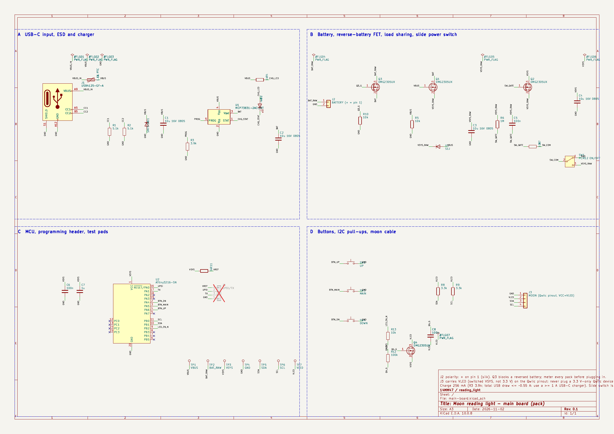

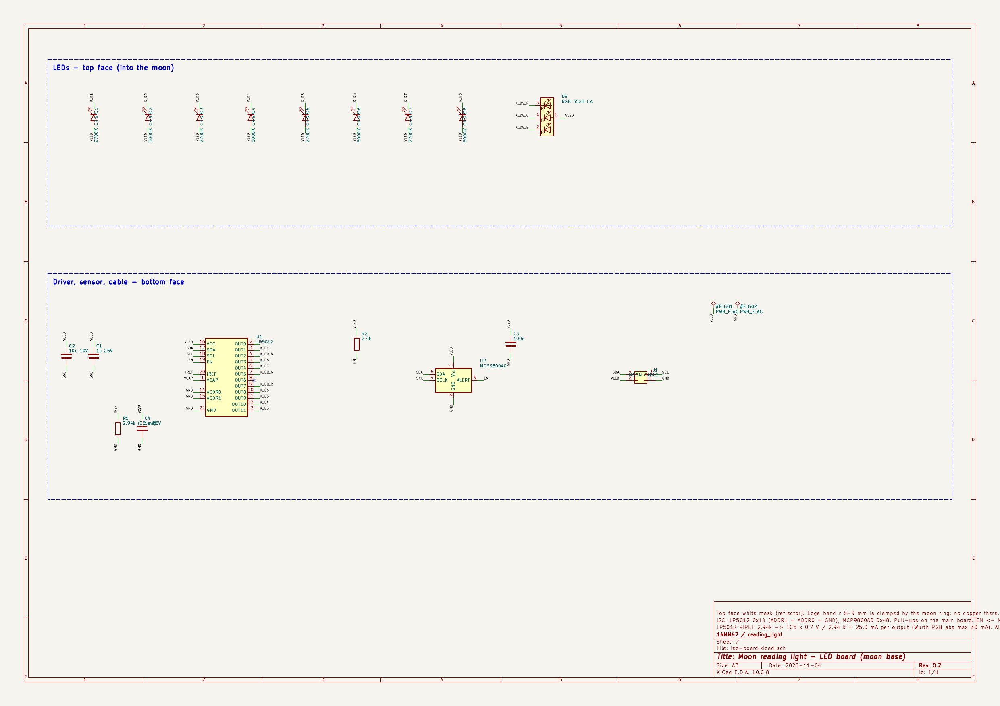
