# SPICE simulation report: moon reading light (main board v0.1 · LED board v0.2 · report rev 2)

**Board versions:** main board **v0.1**, LED board **v0.2** (`REV` in `hardware/*/design.py`, the KiCad title blocks and `fab/<board>/v<rev>/`). Report file: `spice-report_main-v0.1_led-v0.2_rev2`.

| Report rev | Date | Changes |
|---|---|---|
| 1 | 2026-11-08 | First issue (commit 19607f7): 33 runs, 35 checks, findings D1-D6; then the first discussion of D1-D4 with the handover options and source sweep (commit ca6c974). Kept unchanged as `spice-report_main-v0.1_led-v0.2_rev1.md` / `.pdf`, figures in `spice_rev1/`. |
| 2 | 2026-11-08 | Matt's decisions on D1-D6 recorded; D1 handover redesign study (ideal-diode options, parts survey); D3 source-voltage sweep; D4 tail analysis; document rework for D2, D3, D4, D6; simulation rework and checks since rev 1 (section *Rev 2: rework and checks*). |

Generated 2026-11-08 by `python3 sim/run_sims.py` (ngspice-42, 55 runs over 10 circuits plus a model check). **These are predictions, not evidence**: every value nobody has measured is listed under *Assumptions* with the VERIFY item that replaces it.

## Summary

**19 pass, 5 marginal, 4 fail, 7 for information** (35 checks against datasheet limits and the pass criteria in `docs/verification/VERIFY.md`). The FAIL rows are two issues: the USB-unplug dip (as built, plus the two R5 values tried as remedies) and the J3 hot-plug at a low battery.

Decisions (details in *Findings and decisions*; what changed since rev 1 in *Rev 2: rework and checks*):

1. **D1, USB unplug dip** (0.64 V for ~21 ms; E12 allows 0.3 V). The MCU stays up (minimum 2.89 V); the lamp dims ~30 % for that time. R5 can only shorten it (10 ms with 4.7k, 2.5 ms with 1k). **Next revision:** an LM66100 ideal diode in place of Q1 (CE on VBUS) with R5 1k, which cuts it to under 1 ms. **v0.1 handling still to confirm** (recommended: re-word E12, R5 1k if the dim shows).
2. **D2, J3 hot-plug** resets the MCU at a low battery (VSYS 2.30 V). **Accepted** with conditions: J3 is mated once at assembly with SW1 off and strain-relieved; E13 and handoff 05 updated.
3. **D3, weak USB sources**: VSYS 3.71 V at 4.75 V and a false low-battery indication at 4.4 V; 4.00 V on 5.0 V. **Accepted**: 5 V ≥ 1 A charger specified, E15 on 5.0 V; VBUS sense for the next revision.
4. **D4, white headroom with max-VF dies**: **accepted**; whites added to E9.
5. **D5, I²C**: keep 100 kHz. 6. **D6**: Q4 note corrected in `electronics.md`.

What the simulation confirms:

- Q4's soft turn-on works as designed: VLED ramps 10-90 % in 1.1 ms at 2.7 V/ms, and VSYS moves by 10 mV.
- Power-on through Q2 draws 0.64 A peak from a full cell (0.49 A at 3.49 V), with no overshoot on VSYS.
- Plugging USB in peaks at 5.77 V on VBUS and 4.78 V on VSYS (abs max 7 V / 6 V), even with a short, low-resistance cable.
- Load sharing (R18): with the lamp on, the cell still charges at 256 mA and tapers to the 31 mA termination after 5.1 h; USB draw peaks at 0.45 A.
- Battery life to the firmware's empty cut: 6.7 h at 4000 K full, 42 h at soft white level 10, 118 h in red night light (94-158 h for 12-7 mA of electronics). Close to the estimates in `docs/design/electronics.md` §3 (6.5 h, 45 h, 100-150 h).
- The whites stay regulated down to VSYS 3.10 V (typical dies) and 3.40 V (max-VF dies with the worst VSAT), below the 3.45 V low-battery cap. Green/blue need 3.57 V (typical) and 4.12 V (max die) at the board, matching the round-3 figures.

## Findings and decisions to make

For main board v0.1 / LED board v0.2. Options give the simulated effect where it was simulated; "not simulated" marks an engineering estimate. Nothing in the design has been changed; each open item is Matt's call. *If no decision* says what happens by default.

| # | Finding | Severity | Status | Recommendation |
|---|---|---|---|---|
| D1 | USB unplug: VSYS dips 0.64 V for 21 ms | **FAIL** (E12) | next-revision chip discussed; v0.1 handling still to confirm | v0.1: accept, re-word E12 (R5 1k if the dim shows). Next revision: battery-side ideal diode |
| D2 | J3 hot-plug at 3.5 V: VSYS 2.30 V, below BOD | **FAIL** (E13 step) | **decided 2026-11-08**: accepted with conditions; E13 and handoff 05 updated | mate J3 once, SW1 off, strain-relieved |
| D3 | VSYS falls with the USB source voltage (3.71 V at 4.75 V, 3.36 V at 4.4 V) | **MARGINAL** (E15) | **decided 2026-11-08**: A applied, B conditional, C next revision | 5 V ≥ 1 A charger; E15 on 5.0 V |
| D4 | Max-VF white dies dim slightly below VSYS 3.40 V | **MARGINAL** | **decided 2026-11-08**: accepted; whites added to E9 | raise VBAT_LOW_MV only if E9 finds high-VF whites |
| D5 | I²C 419 ns at 150 pF | MARGINAL for fast mode only | **decided 2026-11-08**: keep 100 kHz | none |
| D6 | Q4 charging current 36 mA vs 15-25 mA in the design note | INFO | **done 2026-11-08**: `electronics.md` §1 corrected | none |

### D1. USB unplug handover (VERIFY E12)

**Finding.** Pulling USB with the lamp at 4000 K full drops VSYS from 3.99 V to 2.89 V, 0.64 V below the 3.53 V it settles at on the battery, for 21 ms. The LED-board current falls from 185 mA to about 130 mA (−30 %) for 20 ms. The MCU stays above its 2.6 V BOD, so nothing resets; the risk is a visible dim at the moment of unplugging.

**What happens, step by step** (figure in section 5):

1. On USB, VSYS_RAW is fed through D3 at about VBUS − 0.85 V. Q1's gate sits on VBUS, so Q1 is off and the cell only charges.
2. At the unplug, the lamp drains C1 through D3 and VBUS falls quickly (4.85 → ~3.7 V in ~50 µs).
3. Once VSYS_RAW falls below the cell voltage minus ~0.65 V, Q1's **body diode** starts to carry the lamp. VSYS_RAW is then pinned at about 2.9 V and the diode drop sets the depth of the dip.
4. Q1's channel only turns on when VBUS < VSYS_RAW − |VGS(th)| ≈ 2.2 V. VBUS now sits on C1 (10 µF) and only R5 discharges it, so the time to get there is set by R5·C1. That is why R5 changes the length of the dip and not its depth.

The root cause is the **switch-over threshold**: Q1 waits for VBUS to collapse to ~2.2 V, while USB has really gone as soon as VBUS drops below ~4 V. A fix either shortens step 4 or makes the switch-over happen at a higher VBUS.

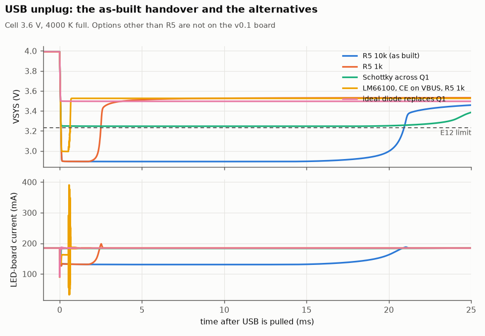

*VSYS and LED current after the unplug for the as-built handover and the alternatives that were simulated.*

**Options simulated** (cell 3.6 V, lamp at 4000 K full; the weak-source column is the 4.75 V charge case):

| Option | Dip depth / time beyond 0.3 V | LED dims for | Charging on a 4.75 V source | Parts, cost, risk |
|---|---|---|---|---|
| As built (R5 10k) | 0.64 V / 20.8 ms | 20.14 ms | as built (5.1 h) | - |
| R5 4.7k (E12's remedy) | 0.64 V / 10.2 ms | 9.87 ms | as built (5.1 h) | value change; +0.6 mA from USB while plugged |
| R5 1k | 0.64 V / 2.4 ms | 2.32 ms | as built (5.1 h) | value change; +4.9 mA (24 mW) from USB while plugged |
| Gate via a small Schottky, own 100k pull-down | 0.64 V / 15.2 ms | 14.57 ms | as built (5.1 h) | 2 parts; **does not help**: VBUS itself stays up |
| 1 A Schottky across Q1 (BAT → VSYS_RAW) | 0.28 V / 0.0 ms | 0.08 ms | **charger does not terminate**: the cell shares the lamp, so R18 load sharing is lost | 1 part (SOD-123); the battery shares the lamp whenever VSYS_RAW < BAT − 0.3 V |
| 4.3 V detector drives Q1's gate | 0.00 V / 0.0 ms | 0.04 ms | **unsafe**: latches with Q1 on at plug-in; USB charges the cell through D3 + Q1 at up to 1.2 A, past the charger | detector IC + resistor |
| TI LM66100 in place of Q1, CE on VBUS (TI's OR-ing circuit), R5 10k | 0.53 V / 3.5 ms | 3.70 ms | charger terminates at 5.1 h | SC-70-6; see the chip discussion below |
| Same, R5 1k | 0.53 V / 0.6 ms | 0.65 ms | charger terminates at 5.1 h | as above, +4.9 mA from USB while plugged |
| Idealised reverse-blocking switch, fixed 3.9 V switch-over (stands in for a TPS2116-class power mux) | 0.00 V / 0.0 ms | 0.05 ms | charger terminates at 5.1 h | see the chip discussion below |

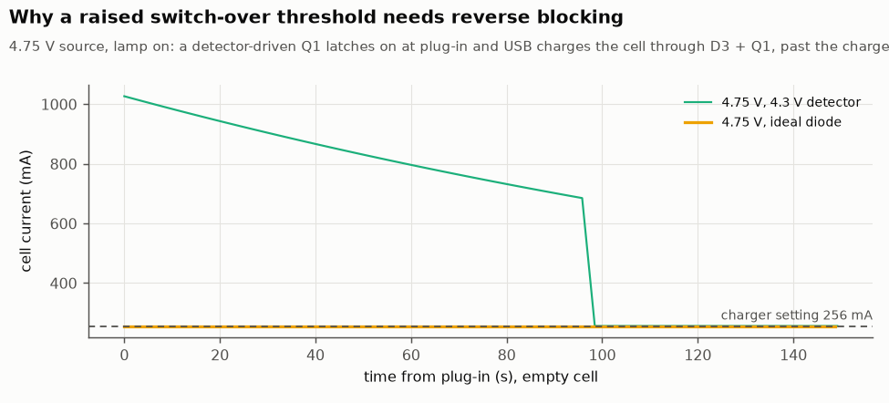

*The detector option on a weak source. Q1 is a bidirectional switch: once it is on while USB is present, D3 + Q1 form a path from USB straight into the cell. With a weak source this is a second stable state: the ~1 A it draws holds VBUS below the detector's release level, so the circuit stays latched (here for ~96 s, until the cell voltage rises). The current design avoids this only because Q1 waits for VBUS to collapse. A raised threshold therefore needs a switch that blocks reverse current.*

**Discussion of the options.**

- *R5* (B, C) is the only change possible on the v0.1 board without new parts. It cannot reduce the depth. With 1k the dim lasts 2.3 ms, probably too short to notice.
- *Schottky across Q1* brings the dip to 0.28 V, just inside E12. Its cost is the D3 interaction: on a weak source the cell feeds part of the lamp through the Schottky (on 4.75 V the charger never terminates while the lamp is on: R18 load sharing is lost). Its reverse leakage into the cell while on USB is µA-level at 25 °C and rises with temperature (not simulated). The 2026-11-02 decision rejected a Schottky for D3 because of leakage with the switch off; across Q1 there is no bias with the switch off, so that concern does not apply here.
- *A detector on Q1's gate* removes the dip but is unsafe as shown above: rejected. The same applies to any bidirectional switch enabled at a raised VBUS threshold, including an LM66100 with a divider on CE (its reverse-current trip needs 0.5-1 A).

#### D1 next revision: the ideal-diode chip

Requirements for the part that replaces Q1: 3.0-4.2 V in; ≥ 0.3 A continuous with ~0.6 A start-up peaks; it must never let USB charge the cell past the MCP73831; it sits ahead of the slide switch, so its own battery current counts against the ≤ 10 µA standby budget (R17: ≤ ~3 µA used today plus the cell's PCM); and it must be hand-solderable (R21: no QFN).

Parts surveyed (TI datasheets read: LM66100 SLVSEZ8A, LM66200 SLVSG04, TPS2116 SLVSFG1A; MAX40200 from an unofficial mirror only, so unverified):

| Part | Type | RON | Battery current | Switch-over | Package | Stock (DigiKey UK, Nov 2026) |
|---|---|---|---|---|---|---|
| **LM66100** | single ideal diode, CE comparator against VIN | 91 mΩ typ / 110 max (3.6 V) | 0.15 µA typ / 0.3 max | on when CE < VIN − 150 mV (40 µs), off when CE > VIN + 35 mV (2 µs) | SC-70-6, 0.65 mm pitch | 296-53541-1-ND, ~£0.27; **0 in stock**, due 21 Dec 2026 |
| TPS2116 | 2-input power mux, priority mode | 40 / 48 mΩ (3.3 V) | 1.35 µA typ, 3.7 max at 85 °C | fixed threshold from a VBUS divider into a 1.0 V ±8 % reference; break-before-make ~8 µs | SOT-583, 0.5 mm pitch | 296-TPS2116DRLRCT-ND, ~£0.85, in stock |
| LM66200 | dual ideal diode, highest input wins | 40 / 48 mΩ | 1.35 µA typ, 3.7 max | 6-8 µs | SOT-583 | not checked |
| MAX40200 | single ideal diode | ~85 mV at 1 A (unverified) | a few µA (unverified) | 65 µs enable (unverified) | SOT-23-5 | not checked |

No charger with built-in power path in a non-QFN package was found (MCP73871 and BQ2407x are QFN). Farnell UK pages could not be checked; re-check stock and the latest datasheet revisions before committing to a part.

**Simulated: LM66100 in TI's OR-ing circuit** (VIN = BAT, VOUT = VSYS_RAW, CE straight to VBUS; S1J kept on the USB side). Behavioural model from the datasheet figures above, body diode ~0.5 V typ:

| R5 | Dip | Time beyond 0.3 V | LED dims for |
|---|---|---|---|
| 10k | 0.53 V | 3.5 ms | 3.7 ms |
| 4.7k | 0.53 V | 2.0 ms | 2.1 ms |
| 1k | 0.53 V | 0.6 ms | 0.6 ms |

Charging on a 4.75 V source with the LM66100 (R5 10k run): the charger terminates at 5.1 h, as on the as-built board.

What this shows:

- The LM66100 does **not** remove the dip outright. Until VBUS falls 150 mV below the cell, its own body diode carries the lamp, so the depth (0.53 V) is close to Q1's. What changes is the switch-over point: VBUS only has to fall to ~VBAT − 0.15 V instead of ~2.2 V, so the dip lasts 3.5 ms instead of 21 ms, and 0.6 ms with R5 1k: invisible.
- It is safe in steady state: with CE on VBUS it can only be on while VBUS is below the cell, so D3 cannot feed the cell through it. Its reverse leakage when off is 0.2 µA typ / 0.5 max at 25 °C. **One transient exception, simulated:** if USB is plugged back in while it is on, it needs its ~2 µs turn-off, and for that time USB reaches the cell through D3 and the LM66100: 1.0 A for about 7 µs (a few µC). That is far too short to matter to the cell or its protection circuit, but it means the part blocks reverse current in steady state, not instantaneously.
- USB plug-in puts up to 5.67 V on CE (VBUS); confirm it against the LM66100's absolute maximum ratings (not extracted in this survey).
- Battery current 0.15-0.3 µA: the standby budget is essentially unchanged.
- On a 4.4 V source (outside the D3 spec) the switch never turns on (VBUS stays above the cell), but its body diode carries part of the lamp from the cell throughout the charge, as Q1's does today, and the charger never terminates while the lamp is on. How much it carries depends on the body-diode drop, which the datasheet gives only as 0.1-1.1 V.
- At switch-on VSYS steps back up by ~0.5 V and the LED board's capacitors recharge: the cable current peaks at 368 mA for a few microseconds (the model ramps the switch in 8 steps over the turn-on; the real part's slew is not specified). Harmless.

**The TPS2116 route** (simulated as the idealised 3.9 V switch above, and as "ideal diodes for Q1 and D3" because the mux replaces both): no dip apart from its ~8 µs break-before-make gap (~0.2 V on VSYS for 8 µs by estimate, not simulated), and one part instead of Q1 + D3. But it puts VBUS almost straight onto VSYS:

- VSYS on a 5.0 V charger rises from 4.00 V to 4.80 V. The LP5012 then drops the difference in its sinks: about 0.35 W instead of 0.21 W at 4000 K full (estimate from the simulated VSYS), in the moon head whose thermal design and firmware derating were fitted to the lower figure (T-series tests).
- A USB plug-in transient reaches 5.38 V at the LED board (as built: 4.76 V), close to the LP5012's 5.5 V recommended maximum.
- It does fix D3: VSYS on a 4.4 V source is 4.17 V, so no false low battery.
- Battery current 1.35 µA typ, 3.7 µA max when hot: a large share of the 10 µA standby budget. The switch-over threshold spreads ±8 % (3.6-4.2 V for a 3.9 V setting) and has no specified hysteresis.

**Recommendation for the next revision.** Replace Q1 with an **LM66100, CE straight to VBUS**, keep the S1J for USB, and lower R5 to 1k (dip under 1 ms, invisible; +4.9 mA from USB while plugged in). It is the smallest change: one SC-70 part in Q1's place and a resistor value. It keeps VSYS and the LED-board thermal design as they are, adds ~0.3 µA at most to the standby drain, and cannot charge the cell past the charger except for the microseconds of its turn-off at a USB re-plug. Add the VBUS sense to an MCU pin at the same time (D3, option C). Check LM66100 stock first (none at DigiKey UK until 21 Dec 2026). The TPS2116 is the alternative if a single part for both inputs is wanted; it needs the thermal and 5.5 V questions above answered first.

**For v0.1** (not yet confirmed): leave the hardware alone and re-word E12 to "no reset; note the dim"; fit R5 = 1k if the dim is visible at the bench.

**If no decision.** E12 fails at the bench against its 0.3 V limit; the lamp works.

### D2. Hot-plugging the LED-board cable (VERIFY E13)

**Finding.** Plugging J3 while VLED is live sags VSYS to 2.30 V at a 3.49 V cell (below the 2.6 V BOD: expect a reset) and to 2.74 V on a full cell. The cable carries a 19 A pulse about 1.5 µs wide. Figure: section 3.

**Matt's context (2026-11-08):** J3 is mated once during assembly, then stays connected inside the casing where it cannot be reached.

**Is that acceptable?** Yes, with two conditions:

1. **Mate J3 with SW1 off** (VSYS is then 0 V and nothing is hot-plugged). Better still, mate it before the battery is plugged in. Then the case never happens in normal use.
2. **The connection must not come loose.** An intermittent J3 contact (for example from the gooseneck flexing) would repeat the hot-plug each time it reconnects: an MCU reset at a low battery, and the light coming back in its power-on mode. JST-SH has a friction lock only, so route the cable with strain relief and no tension on the plug. This is an annoyance, not a hazard: the 19 A pulse lasts ~1.5 µs (I²t ≈ 3 × 10⁻⁴ A²s), far too short to heat the contacts.

Bulk capacitance on VSYS (47 µF) would only lift the low-battery case to 2.72 V and raises the power-on inrush from 0.64 A to 1.68 A, so it is not worth adding for a connector that is mated once.

**Decision (Matt, 2026-11-08): accepted with these conditions.** Done: VERIFY E13 no longer hot-plugs J3, and handoff 05 §4.3 now says to check SW1 is OFF before plugging J3. Strain relief was already specified there (a 10-15 mm service loop and silicone at the gooseneck bore entrance, because the JST-SH has no latch).

### D3. VSYS on a weak USB source (VERIFY E15)

**Finding.** On USB, VSYS = VBUS − (cable + F1 drop) − D3's ~0.85 V, so it follows the charger's voltage and the cable. The firmware reads VSYS as "battery voltage", so a low VSYS on USB looks like a low battery to it. Charging with the lamp at 4000 K full (all cases through a 0.2 Ω cable, F1 at its 0.2 Ω maximum):

| Source at the plug | VSYS (min) | Firmware sees | Cell current through Q1's body diode | Charge time |
|---|---|---|---|---|
| 5.0 V | 4.00 V | normal | 0.0 mA | 5.1 h |
| 4.75 V (USB minimum at the port) | 3.71 V | normal | 0.5 mA | 5.1 h |
| 4.5 V | 3.46 V | normal | 94.5 mA | **does not terminate** (7 h run) |
| 4.4 V (USB 2.0 bus-powered hub minimum) | 3.36 V | **low battery** for 4.6 h (35 % cap, warning blinks) | 157.5 mA | **does not terminate** (7 h run) |

With the lamp off on a 4.4 V source VSYS is 3.65 V, below the firmware's 3.70 V resume level (VBAT_RESUME_MV): a lamp that went to empty-sleep would not wake until the charge current tapers.

**Discussion.**

- Charge termination is judged on the MCP73831's own output current (rev 2 correction: rev 1 used the cell current). When VSYS_RAW falls more than ~0.6 V below the cell, Q1's body diode lets the cell carry part of the lamp (up to 158 mA at 4.4 V). The charger then supplies that as well, its output never falls to the 31 mA termination level, and **with the lamp on from a ≤ 4.5 V source the charge never terminates**: the cell is held at 4.20 V (CV) and the charge LED stays on until the lamp is switched off or a better charger is used. Nothing exceeds a rating (the charger still limits the cell to 4.20 V), but holding a LiPo at 4.20 V for long periods ages it faster. This strengthens recommendation A (a 5 V charger).
- The user-visible effects are firmware ones: a false low-battery warning and a 35 % brightness cap on very weak sources, and a late wake from empty-sleep.
- A good USB-C charger delivers 5.0-5.2 V, and handoff 02 already asks for a ≥ 1 A charger. Weak sources are laptop ports through long thin cables, and bus-powered hubs.
- Firmware could avoid the false warning if it knew USB was present. The v0.1 board has no VBUS sense pin on the MCU (VBUS → divider → ADC would need a board change), so a firmware-only fix would have to infer USB from VSYS rising above the cell's possible range, which is not reliable.
- The D1 ideal-diode redesign (threshold ~3.9 V) does not raise VSYS on a weak source, since the lamp still runs through D3, but it stops the cell from feeding the lamp through Q1's body diode, so the charge at 4.4 V terminates at 5.1 h instead of never.

**Options.** (A) Specify the source: run E15 on a 5.0 V charger and state "5 V ≥ 1 A USB-C charger" in the user notes (no cost). (B) Lower VBAT_RESUME_MV to 3600 mV (E15's own remedy; firmware constant, costs a little hysteresis against bouncing out of empty-sleep). (C) Next revision: VBUS sense to an MCU pin, so the firmware can tell USB from a low battery.

**Decision (Matt, 2026-11-08): recommendations accepted.** A done: E15 is run on a 5.0 V, ≥ 1 A charger and handoff 05's user notes ask for one. B stays as E15's remedy, applied only if the bench shows the late wake. C is on the next-revision list with D1.

### D4. White-LED headroom with maximum-VF dies (VERIFY E9)

**Finding.** Each white channel needs VLED ≥ VF + VSAT for its full 25 mA. With typical dies that holds down to VSYS 3.10 V. With the highest-VF dies (2.92 V at 25 mA) **and** the worst LP5012 saturation voltage (0.45 V, assumed: not specified at 25 mA) it holds down to VSYS 3.40 V, just below the firmware's 3.45 V brightness cap. Figure: section 8.

**How much it matters.** Worst-case channel current from the headroom sweep: 24.2 mA (-3%) at the 3.45 V cap, 23.8 mA at 3.40 V, 22.5 mA (-10%) at the 3.30 V empty cut. This only happens in the last ~7% of the charge (at 4000 K full the cap arrives at 6.0 h, the cut at 6.7 h), when the firmware has already reduced brightness to 35 %, so a further few-percent dimming is hard to see. The cap lowers the average current but not the 25 mA peak per channel, so it does not restore the headroom by itself.

The one visible effect could be **colour**: if the 2700 K and 5000 K dies come from different VF bins, the higher-VF group dims first, and mixed whites drift slightly in the last few percent of the battery (not simulated; estimated as small next to the step from the 35 % cap).

**Options.** (A) Accept. (B) Raise VBAT_LOW_MV from 3450 to ~3500 mV, so the cap arrives before any channel can drop out (firmware constant; costs a little time at full brightness). (C) RIREF 3.65 kΩ (20 mA per channel, −20 % light), already listed under E9 for the green/blue dies. (D) Order a known low-VF bin (Bridgelux VF bins B-E); the stocked part is the full-distribution code, so this depends on availability.

**Decision (Matt, 2026-11-08): accept (A).** Done: E9 now also measures one 2700 K and one 5000 K white at 25 mA; if either reads above ~2.85 V, raise VBAT_LOW_MV to 3500 (B).

### D5. I²C speed: decided (keep 100 kHz)

Rise times 168 / 280 / 419 ns for 60 / 100 / 150 pF are inside standard mode (1000 ns). **Decision (Matt, 2026-11-08): keep 100 kHz.** Moving to 400 kHz would need a measured bus capacitance below about 100 pF or stronger pull-ups.

### D6. Documentation correction: done

`docs/design/electronics.md` §1 said Q4's soft turn-on charges the LED board with 15-25 mA. The simulation gives up to 36 mA, because the MLCCs start near their unbiased value. **Done (2026-11-08):** the note now gives the simulated 25-36 mA and the reason.

## Rev 2: rework and checks

Everything done between report rev 1 and rev 2: the decisions Matt made on D1-D6, the documents changed as a result, the simulations added, the corrections to the simulation itself, and how rev 2 was checked.

### Decisions recorded (Matt, 2026-11-08)

| # | Decision | Action taken | Files |
|---|---|---|---|
| D1 | Discuss the next-revision ideal-diode chip | Redesign study and parts survey (D1 above); the v0.1 handling (re-word E12, R5 1k fallback) is still to confirm | this report |
| D2 | Accepted with conditions: J3 mated once at assembly, SW1 off, strain-relieved | Assembly step and VERIFY E13 updated | `docs/handoffs/05-assembly-bringup.md` §4.3, `docs/verification/VERIFY.md` E13 |
| D3 | Recommendations accepted: (A) specify a 5 V ≥ 1 A charger and run E15 on 5.0 V; (B) lower VBAT_RESUME_MV only if E15 shows a late wake; (C) VBUS sense in the next revision | (A) applied; (B) left as E15's remedy; (C) on the next-revision list | VERIFY E15, handoff 05 §6, `PLAN.md` |
| D4 | Accepted | Whites added to the VF measurement in E9, with the trigger for raising VBAT_LOW_MV | VERIFY E9 |
| D5 | Keep I²C at 100 kHz | none needed (firmware already at 100 kHz) | `PLAN.md` |
| D6 | Correct the Q4 note | Done | `docs/design/electronics.md` §1 |

### Simulations added in rev 2

All in `sim/run_sims.py` (CASES) and re-run with the rest; redesign elements are in marked blocks of `sim/boards.inc` that the runner removes for the as-built board (an assertion checks Q1 and D3 are present).

| Case / variant | Purpose | Key result |
|---|---|---|
| usb_unplug / gd | gate fed through a small Schottky | no improvement (dip 0.64 V): VBUS itself stays up |
| usb_unplug / sch | Schottky across Q1 | dip 0.28 V |
| usb_unplug / det43, charge / weak_det43 | VBUS detector on Q1's gate | dip removed, but a latched state charges the cell from USB at 1.2 A: rejected |
| usb_unplug / idd, charge / weak_idd, v44_idd | ideal diode in place of Q1, enabled below 3.9 V | no dip; charge 5.1 h at 4.75 V and 5.1 h at 4.4 V |
| charge / v44_idd435 | same, enabled below 4.35 V | stalls charging on a 4.4 V source (70 mA net after 4 h): threshold must stay below the weakest charger |
| usb_unplug / dual, usb_hotplug / dual_r01, charge / dual_5, dual_44 | ideal diodes for both Q1 and D3 | no dip; VSYS 4.80 V on 5.0 V and 4.17 V on 4.4 V; plug-in peak 5.38 V at the LED board |
| usb_unplug / lm, lm_r5_4k7, lm_r5_1k, charge / lm_weak, lm_44 | TI LM66100 in place of Q1, CE on VBUS | dip 0.53 V for 3.5 ms (R5 10k), 0.6 ms (R5 1k); charge unchanged at 4.75 V |
| usb_hotplug / lm_r01 | USB re-plug while the LM66100 is on | 1.0 A into the cell for ~7 µs during its turn-off |
| charge / v45, v44, v44_dark | source-voltage sweep (D3) | VSYS 3.46 / 3.36 V with the lamp on; 3.65 V lamp off at 4.4 V |

### Corrections to the simulation since rev 1

Found by the two independent reviews (of the rev 1 diff and of the rev 2 diff) or while adding the rev 2 cases. Each is fixed in the code, and every number in this report is the corrected one.

1. **I²C rise times were ~8× too fast** (review 1). A `.meas … when v(sda)={0.3*vled}` inside `.control` does not evaluate the `{}` expression, so the thresholds were 0.3 V and 0.7 V absolute. Rise times are now computed in Python from the waveform, with an assertion against the analytic 0.847·RC. Corrected 21/36/54 ns → 168/280/419 ns; I1-c150 changed from PASS to MARGINAL.
2. **Q4 and power-on 10-90 % times** had the same cause (hard-coded or unevaluated levels). Now taken from each run's final value: Q4 1.02 → 1.06 ms at 3.49 V; power-on VSYS rise 53 → 76 µs. No verdict changed.
3. **J3 hot-plug timing in the text** (review 1): the current pulse is ~1.5 µs wide (was "well under a microsecond") and VSYS recovers over ~50 µs (was ~10 µs). Conclusions unchanged.
4. **Weak-USB case description** (review 1): it includes a 0.2 Ω USB cable, and 0.2 Ω is the PTC's maximum *cold* resistance, not a warm value. Check C2 is judged on the body-diode current (0.46 mA, against the 31 mA termination) instead of a voltage threshold.
5. **Charge termination was measured on the cell current** (review 2). The MCP73831 terminates on its own output current, which also includes whatever leaves BAT through Q1's body diode (or the Schottky, or the LM66100's body diode) into the lamp. A 0 V sense source on the charger output now gives that current. Effect: with the lamp on, the as-built board **does not terminate** on 4.5 V and 4.4 V sources (rev 1's first discussion said 5.3 h and 5.8 h), and the Schottky-across-Q1 option does not terminate even at 4.75 V (was 6.1 h). The 5.0 V and 4.75 V as-built results are unchanged (5.1 h).
6. **Redesign elements leaked into the as-built netlist.** Adding the D1 options to the shared board model broke convergence of the J3 hot-plug case even with them disconnected; they now sit in marked blocks that the runner removes. A first version of that removal also deleted Q1 and D3 (the marker text appeared inside a comment); this was caught by a missing measurement, fixed by anchoring the markers to whole lines, and is now guarded by an assertion. Review 2 confirmed the as-built netlists match rev 1 as circuits.
7. **Option isolation.** In the first LM66100 runs the idealised option's path was still connected (its isolation tested `q1gd > 2.5` instead of `q1gd == 3`), which made the LM66100 look dip-free. Caught by probing VBUS, BAT and the enable node; each option now connects only its own elements (checked element by element in review 2).
8. **Ideal-diode model formulation.** A behavioural B-source version converged to a false operating point (VSYS ~606 V, held by D3's 600 V reverse breakdown). Replaced by a voltage-controlled switch (80 mΩ) in series with a near-ideal diode (~30 mV at 0.2 A).
9. **LM66100 switch-on** (review 2): a one-step switch made a ~1 A current spike at turn-on that the text dismissed without evidence. The switch is now 8 parallel stages closing over the enable ramp; the spike falls to the LED board's capacitors recharging and is reported with its size. (A continuous B-source conductance was tried first and did not converge.)
10. **Parts-survey claim corrected.** The survey expected the LM66100 to cut the dip to ~40 µs. The simulation shows its body diode carries the lamp until VBUS falls 150 mV below the cell, so the dip keeps its depth and lasts a few milliseconds (under 1 ms with R5 1k).
11. **The detector option has a second stable state** (latched at plug-in, ~1 A from USB into the cell); it is a property of the circuit, not of the solver, and is why that option is rejected.
12. **E15 could no longer trigger D3 remedy B** (review 2): run on a 5.0 V charger, VSYS stays above the 3.70 V resume level, so a late wake cannot show. E15 now adds an informational wake check on the weakest charger Matt actually uses.

### How rev 2 was checked

- As-built results: every rev 1 check gives the same value in rev 2 apart from the corrections listed above (19 pass, 5 marginal, 4 fail, 7 info).
- Each new variant was run on its own first and its waveforms inspected (the D1 figures); two anomalies were investigated before being reported (a 37-48 µs LED-current blip at switch-over, which is real and invisible; the detector latch, which is real and disqualifying).
- Static checks on `sim/`: ruff (pyflakes rules) and mypy clean. The repo's `tests/test_consistency.py` gives 3 pass and 1 fail, the same failure as on the unchanged branch (`test_board_map_matches_led_netlist`, needs KiCad's `pcbnew`).
- Two independent diff reviews: of rev 1 (4 findings) and of the rev 2 changes (option isolation, the LM66100 model against its datasheet figures, every rev 2 number against the results file, the document edits). Review 2 found the termination metric (item 5), the E15 trigger (item 12), the switch-on spike (item 9), an out-of-order list and small text issues; all fixed. It also asked for an LM66100 USB re-plug case, which found the transient in D1.
- Report files: `spice-report_main-v0.1_led-v0.2_rev2.md` and `.pdf`. Rev 1 is kept unchanged and marked as rev 1 (`spice-report_main-v0.1_led-v0.2_rev1.md` / `.pdf`, figures in `spice_rev1/`).

## All checks

| ID | Area | Check | Simulated | Limit | Verdict |
|---|---|---|---|---|---|
| P1-full | Power-on (SW1) | Cell inrush peak, cell 4.18 V | 0.64 A | < ~3 A (typical DW01-class PCM over-current trip, PROVISIONAL); Q2 IDM 15 A | **PASS** |
| P1-low | Power-on (SW1) | Cell inrush peak, cell 3.49 V | 0.49 A | < ~3 A (typical DW01-class PCM over-current trip, PROVISIONAL); Q2 IDM 15 A | **PASS** |
| P1-full_bulk47 | Power-on (SW1) | Cell inrush peak, cell 4.18 V, + 47 uF on VSYS | 1.68 A | < ~3 A (typical DW01-class PCM over-current trip, PROVISIONAL); Q2 IDM 15 A | **PASS** |
| P2 | Power-on (SW1) | VSYS rise 10-90 % and overshoot | 76 us, overshoot 0 mV | monotonic, no overshoot | **PASS** |
| Q1 | Q4 soft turn-on | VLED ramp at the LED board (10-90 %), cell 3.49 V | 1.06 ms, 2.66 V/ms max | ramps over ~1-2 ms (E13); 2.5 V/ms design | **PASS** |
| Q2 | Q4 soft turn-on | VSYS dip, worst of 4 corners | 12 mV | <= 200 mV (E13) | **PASS** |
| Q3 | Q4 soft turn-on | Peak LED-board charging current, worst corner | 36 mA | design note says 15-25 mA | **INFO** |
| J1-full | J3 hot-plug | VSYS minimum, cell 4.18 V | 2.74 V | > 2.6 V (ATtiny BOD level, fuses: bod = 2.6v) | **MARGINAL** |
| J1-low | J3 hot-plug | VSYS minimum, cell 3.49 V | 2.30 V | > 2.6 V (ATtiny BOD level, fuses: bod = 2.6v) | **FAIL** |
| J1-low_bulk47 | J3 hot-plug | VSYS minimum, cell 3.49 V, + 47 uF on VSYS | 2.72 V | > 2.6 V (ATtiny BOD level, fuses: bod = 2.6v) | **MARGINAL** |
| J2 | J3 hot-plug | Peak cable current / LED-board peak voltage | 19.1 A / 4.18 V | LED board <= 6 V abs max (LP5012, MCP9800) | **PASS** |
| U1-r01 | USB plug-in | VBUS peak, 5.25 V, cable 0.1 Ohm | 5.77 V | < 7.0 V (MCP73831 abs max); TVS VBR 6.4 V min | **PASS** |
| U2-r01 | USB plug-in | VSYS / LED-board peak, 5.25 V, cable 0.1 Ohm | 4.78 / 4.76 V | < 6.0 V (ATtiny3216, LP5012 abs max) | **PASS** |
| U1-r03 | USB plug-in | VBUS peak, 5.25 V, cable 0.3 Ohm | 5.06 V | < 7.0 V (MCP73831 abs max); TVS VBR 6.4 V min | **PASS** |
| U2-r03 | USB plug-in | VSYS / LED-board peak, 5.25 V, cable 0.3 Ohm | 4.20 / 4.18 V | < 6.0 V (ATtiny3216, LP5012 abs max) | **PASS** |
| U3 | USB plug-in | Attach inrush peak from the charger | 10.1 A | USB 2.0: <= 10 uF at attach without inrush limiting | **INFO** |
| H1-r5_10k | USB unplug | VSYS dip below battery level, R5 10k (as built) | 0.64 V for 21 ms (>0.3 V); min 2.89 V | <= 0.3 V, no reset (E12); BOD 2.6 V | **FAIL** |
| H1-r5_4k7 | USB unplug | VSYS dip below battery level, R5 4.7k (E12 remedy) | 0.64 V for 10 ms (>0.3 V); min 2.89 V | <= 0.3 V, no reset (E12); BOD 2.6 V | **FAIL** |
| H1-r5_1k | USB unplug | VSYS dip below battery level, R5 1k | 0.64 V for 3 ms (>0.3 V); min 2.89 V | <= 0.3 V, no reset (E12); BOD 2.6 V | **FAIL** |
| H2 | USB unplug | LED current during the handover (4000 K full) | 185 mA -> 90 mA | no visible step (no spec) | **INFO** |
| C1 | Charge + load share | Charger terminates with the lamp on (R18) | I_bat falls to 31 mA at 5.09 h; Q1 body diode max 0.19 V forward | termination reached; Q1 body diode < 0.4 V (not conducting) | **PASS** |
| C2 | Charge + load share | Same, weak USB (4.75 V, PTC 0.2 Ohm cold max, cable 0.2 Ohm) | Q1 body diode 0.47 V forward, 0.46 mA from the cell into VSYS; terminates at 5.09 h | body-diode current < 3.1 mA (10 % of the 31 mA termination) | **PASS** |
| C3 | Charge + load share | Peak USB current, charging + 4000 K full | 0.447 A | <= ~0.8 A (F1 hold at 60 C); E11 expects 0.5-0.6 A | **PASS** |
| C4 | Charge + load share | VSYS on USB (minimum over the charge) | 4.00 V (5.0 V USB); 3.71 V (4.75 V, PTC 0.2 Ohm) (both with a 0.2 Ohm cable) | >= 3.9 V (E15) | **MARGINAL** |
| C5 | Charge + load share | MCP73831 dissipation, peak | 0.46 W | <= 0.69 W design worst case (thermal regulation above) | **PASS** |
| R1-4000k | Runtime | Battery life, 4000 K full | 6.7 h to the empty cut (4.45 Wh delivered; brightness cap after 6.0 h) | estimate 6.5 h (electronics.md 3) | **INFO** |
| R1-soft10 | Runtime | Battery life, soft white level 10 | 42.0 h to the empty cut (4.50 Wh delivered; brightness cap after 40.1 h) | estimate 45 h (electronics.md 3) | **INFO** |
| R1-night | Runtime | Battery life, red night level 4 | 118.2 h to the empty cut (4.51 Wh delivered; brightness cap after 115.1 h) | estimate 100-150 h (electronics.md 3) | **INFO** |
| D1 | LED headroom | Whites stay regulated down to the low-battery cut (8 on together) | 95 % point at VSYS 3.10 V / cell OCV 3.17 V (typ); VSYS 3.40 V / OCV 3.47 V (max-VF dies, VSAT 0.45 V) | VSYS edge < 3.45 V (VBAT_LOW is measured on VSYS under load) | **MARGINAL** |
| D2 | LED headroom | Green/blue regulation edge (VLED at the board) | typ die 3.57 V; max-VF die 4.12 V | design: ~3.65 V typ, ~4.05-4.15 V max die (round3 R3-E3) | **INFO** |
| W1-d50 | PWM ripple | Ripple, all whites in phase, 50 % duty | VLED 82 mV p-p (min 3.65 V); VSYS 59 mV p-p | LP5012 VCC >= 2.7 V; VSYS > 2.6 V | **PASS** |
| W1-d89 | PWM ripple | Ripple, all whites in phase, 88.75 % duty (4000 K full) | VLED 48 mV p-p (min 3.64 V); VSYS 30 mV p-p | LP5012 VCC >= 2.7 V; VSYS > 2.6 V | **PASS** |
| I1-c60 | I2C | Rise time 30-70 %, 60 pF | 168 ns | <= 1000 ns (standard mode, 100 kHz) | **PASS** |
| I1-c100 | I2C | Rise time 30-70 %, 100 pF | 280 ns | <= 1000 ns (standard mode, 100 kHz) | **PASS** |
| I1-c150 | I2C | Rise time 30-70 %, 150 pF | 419 ns | <= 1000 ns (standard mode, 100 kHz) | **MARGINAL** |

MARGINAL means inside the limit with less margin than this report's own rule of thumb (stated per check in `sim/run_sims.py`). INFO rows have no hard limit.

## The circuits as simulated

SPICE subcircuits in `sim/boards.inc` follow the reference designators of the two boards. Device models are in `sim/models.inc`; each is fitted to datasheet points (checked in the *Model check* table below).

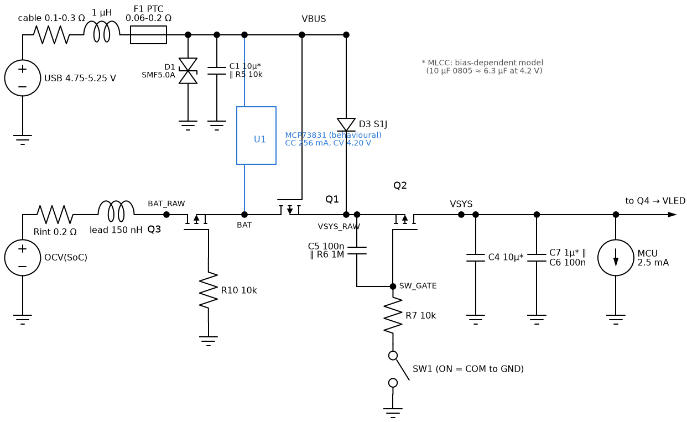

*Main-board power path: cell model, reverse-battery FET Q3, load-share FET Q1 (gate on VBUS), D3 from USB, the slide-switch FET Q2 with its R7/C5 soft start, and the VSYS loads. The charger is a behavioural CC/CV source.*

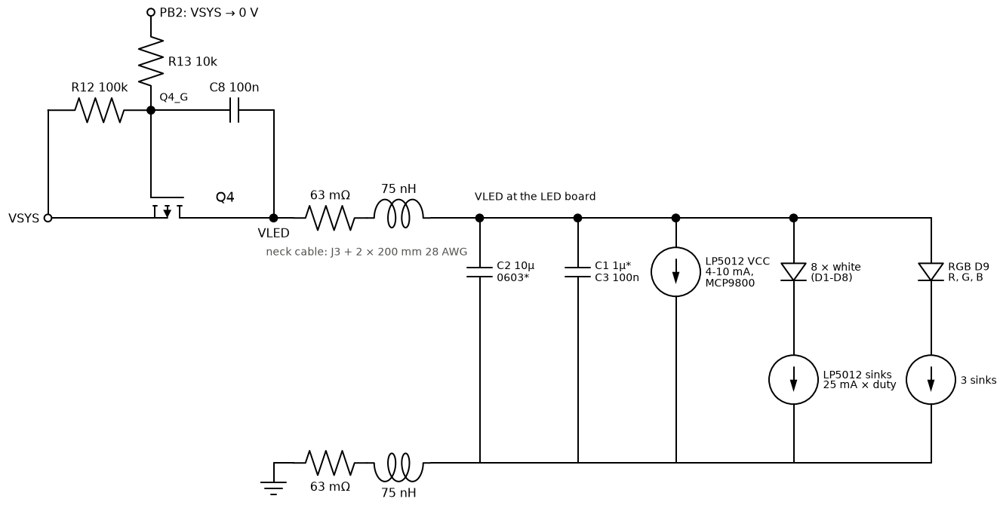

*Q4 with its Miller soft start (R13 into C8), the neck cable (both conductors), and the LED board: bulk and bypass MLCCs, LP5012 supply current, and the LED channels as LED + LP5012 sink.*

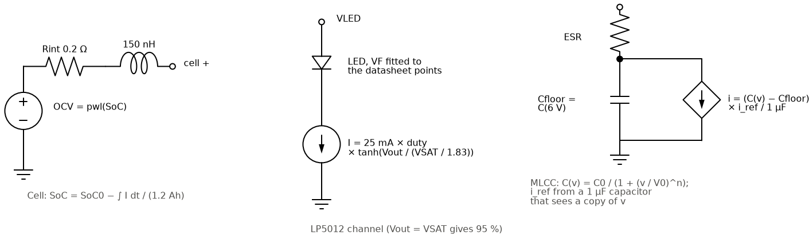

*Behavioural models: the cell (open-circuit voltage from the state of charge), one LP5012 channel, and the bias-dependent MLCC.*

## 1. Power-on inrush (slide switch, Q2)

SW1 pulls Q2's gate down through R7 10k; C5 (100 nF) sits gate-to-source, so the gate voltage falls with a 1 ms time constant and Q2 turns on hard once it passes its threshold. The VSYS capacitors (C4 10 µF, C7 1 µF, C6 100 nF; about 7 µF at 4 V) then charge through the cell, Q3, Q1 and Q2.

Peak cell current 0.64 A (full cell) and 0.49 A (3.49 V); VSYS rises 10-90 % in 76 µs with no overshoot. Round 1 had predicted 0.7-1.3 A into 14-21 µF; the LED board now sits behind Q4, so Q2 sees less capacitance. With 47 µF added on VSYS (the E13 remedy) the peak rises to 1.68 A, still well below the FET's 15 A pulse rating but closer to the cell PCM's over-current trip (typically ~3 A on DW01-class protectors; not documented for this cell).

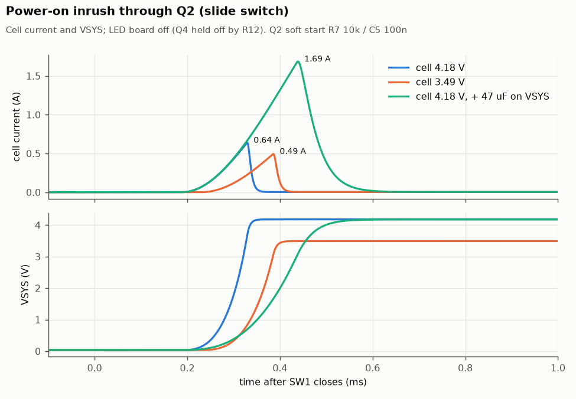

## 2. Q4 soft turn-on of the LED board

PB2 drives Q4's gate through R13 10k with C8 100 nF from gate to drain: the Miller plateau holds the gate while C8 charges, so VLED rises at about (VSYS − |VGS(plateau)|) / (R13 · C8). The LED board is in standby (LEDs off), so it loads VLED with its MLCCs only. Four corners: cell 3.49 V / 4.18 V and Q4 threshold −0.5 / −0.9 V.

At 3.49 V (the E13 condition) VLED takes 1.06 ms from 10 to 90 %, peak 2.66 V/ms, and the charging current peaks at 29 mA (36 mA worst corner). VSYS moves by 10 mV. The current is higher than the design note's 15-25 mA because the MLCCs start at their unbiased value (about 11 µF at 0 V, falling to about 4.5 µF at 3.5 V); it is still harmless.

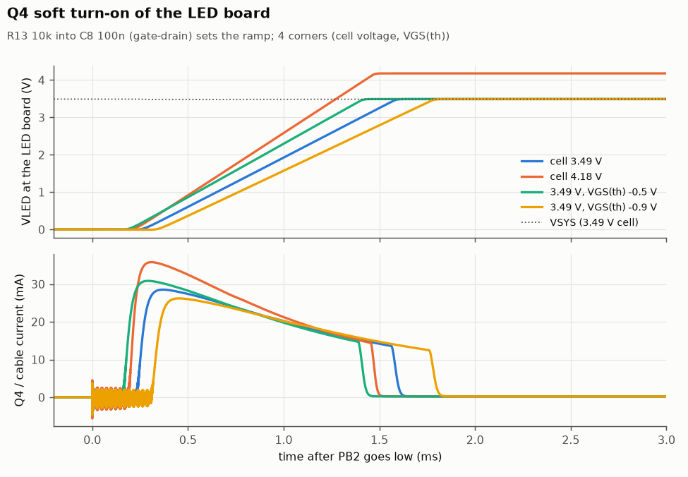

## 3. Hot-plugging the LED-board cable

With Q4 on, plugging the cable connects the LED board's empty MLCCs straight to VSYS. The main board has no bulk capacitance on VLED, so C4 shares its charge with them within about 2 µs; the cell, behind its resistance and lead inductance, brings VSYS back over the next ~50 µs.

The cable current peaks at 19 A in a pulse about 1.5 µs wide. VSYS falls to 2.74 V on a full cell and to 2.30 V at 3.49 V, below the ATtiny's 2.6 V BOD level, so expect a reset. With 47 µF on VSYS the 3.49 V case bottoms at 2.72 V. The BOD's response time to a dip of a few microseconds is not modelled; a short dip may not trip it, so treat this as the worst case. The LED board never exceeds VSYS (no overshoot).

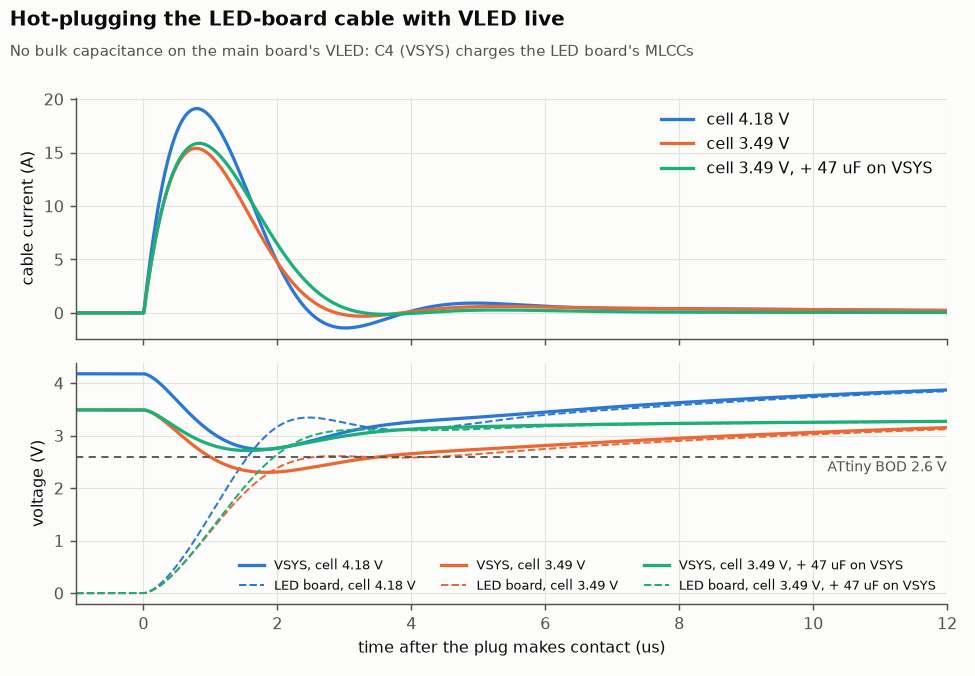

## 4. Plugging in USB while the lamp runs

A 5.25 V source (top of the USB tolerance) through a 1 µH cable is connected while the lamp runs at 4000 K from a 3.74 V cell. The cable rings with C1, and D3 also charges VSYS_RAW/VSYS up from the battery level.

With a 0.1 Ω cable, VBUS peaks at 5.77 V (MCP73831 abs max 7 V; the TVS does not conduct) and VSYS at 4.78 V (ATtiny and LP5012 abs max 6 V). With 0.3 Ω the peaks are 5.06 V / 4.20 V. The charger supplies a 10 A peak for a few microseconds; USB 2.0 asks a device to present no more than 10 µF at attach, and C1 is 10 µF nominal, but D3 adds C3/C4 while VSYS_RAW sits below VBUS − 0.85 V. Most chargers ride through it; no action proposed.

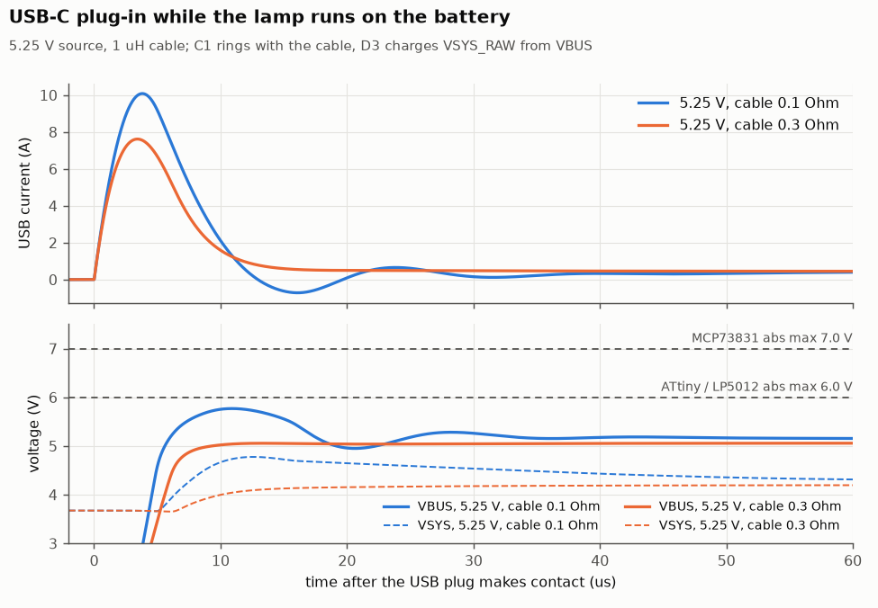

## 5. Unplugging USB (handover to the battery)

On USB, VSYS comes through D3 and Q1 is held off because its gate sits on VBUS. When USB is pulled, the lamp first drains C1 through D3, then Q1's body diode takes the load (cell → VSYS_RAW, about 0.65 V drop). Q1's channel turns on only when R5 has discharged VBUS below VSYS_RAW − |VGS(th)|. Cell 3.6 V, lamp 4000 K full (the E12 condition).

VSYS falls from 3.99 V to 2.89 V, 0.64 V below the 3.53 V it settles at on the battery, for 21 ms with R5 10k. R5 4.7k and 1k shorten this to 10 ms and 2.5 ms but do not reduce the depth. The MCU stays above its BOD; the whites lose headroom and the LED-board current drops by about 30 % for that time.

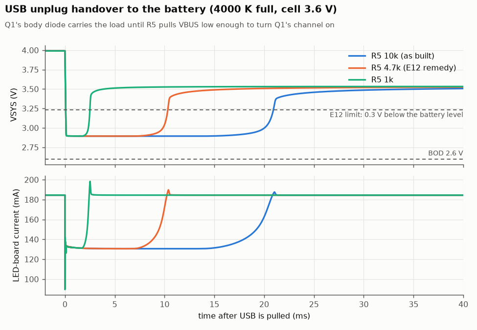

## 6. Charging with the lamp on (load sharing)

A full charge from an empty cell (3.0 V) on a 5.0 V source, with the lamp at 4000 K full for the whole charge, with it off, and on a weak source (4.75 V, PTC at its 0.2 Ω maximum); all through a 0.2 Ω USB cable. The MCP73831 model is CC 256 mA / CV 4.20 V; the 31 mA termination point is read off the cell current.

The cell current is the same with and without the lamp: the lamp is fed from D3, so the charger sees only the cell and reaches its 31 mA termination after 5.1 h either way (R18). Peak USB current 0.45 A (lamp on) and 0.26 A (off); charger dissipation peaks at 0.46 W. VSYS stays at 4.00 V or more on the 5.0 V source but drops to 3.71 V on the weak one.

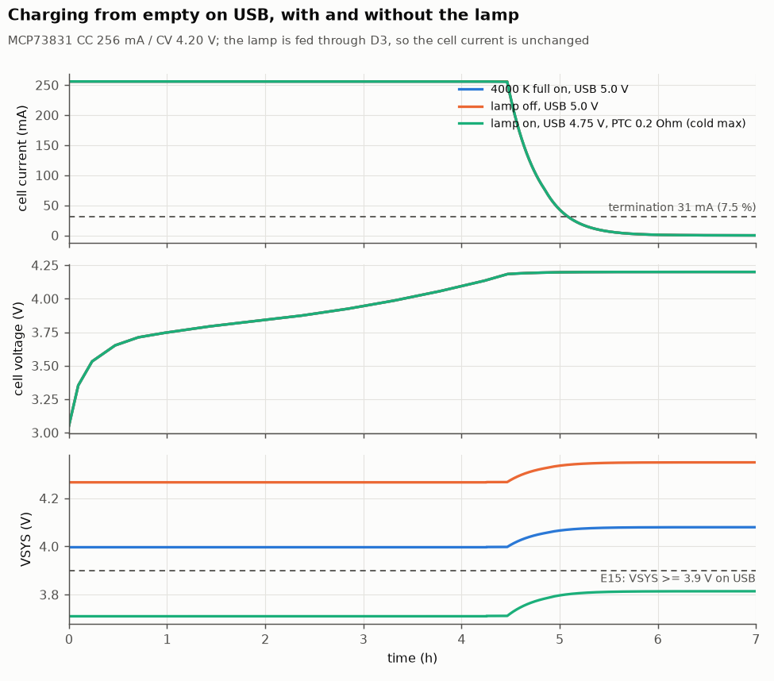

## 7. Battery life per mode

Discharge from full at a fixed mode until VSYS (which the firmware measures under load) falls to 3.30 V. Below 3.45 V the firmware caps brightness to 35 %, modelled as a latch. LED drive is the average PWM duty on the LP5012 sinks; electronics are MCU 2.5 mA + LP5012 6.8 mA + MCP9800 0.2 mA. Thermal derating is not modelled, so the 4000 K figure is an upper bound once the head warms.

4000 K full: 6.7 h (brightness cap after 6.0 h; estimate 6.5 h). Soft white level 10: 42 h (estimate 45 h). Red night level 4: 118 h (estimate 100-150 h; 94-158 h for 12-7 mA of electronics, which dominate at this level). Every mode delivers about 4.45 Wh before the cut.

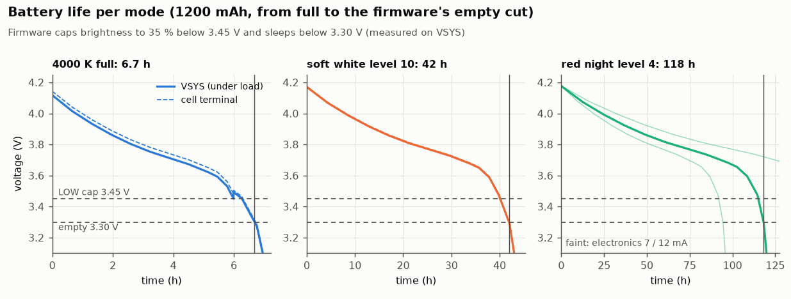

## 8. LED channel headroom

DC sweep of the cell's open-circuit voltage with 0.2 Ω cell resistance and the full path (Q3, Q1, Q2, Q4, cable). Left: all eight whites on at once, the instantaneous peak of 4000 K full (200 mA). Right: the Green mode. Typical dies with VSAT 0.30 V, and maximum-VF dies with VSAT 0.45 V (VSAT at 25 mA is not specified).

The whites hold 95 % of 25 mA down to VSYS 3.10 V (typical) and 3.40 V (worst case), so they are regulated wherever the firmware runs at full brightness. Green needs VLED 3.57 V at the board with a typical die (design note: ~3.65 V) and 4.12 V with a maximum-VF die (design note: 4.05-4.15 V). A worst-case die reaches only 15 mA at a 3.7 V cell. VERIFY E9 measures the received dies.

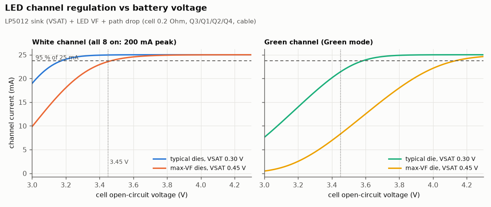

## 9. PWM ripple at 29 kHz

All eight whites switching together at the LP5012's 29 kHz, which is the worst case: the datasheet extract does not say whether the LP5012 staggers its outputs. 50 % duty gives the largest ripple; 88.75 % is 4000 K full.

At 50 % duty, VLED at the LP5012 swings 82 mV p-p (minimum 3.65 V) and VSYS 59 mV p-p. Far from the LP5012's 2.7 V minimum and the MCU's BOD; the ATtiny's ADC reading of VDD will see this ripple, which the firmware averages.

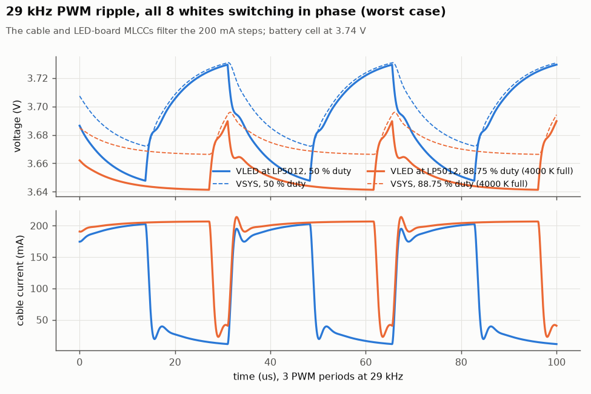

## 10. I²C rise time

R8/R9 3.3 kΩ to VLED against the bus capacitance (MCU pin, 200 mm cable, LP5012, MCP9800): 60-100 pF estimated, 150 pF as margin.

Rise time (30-70 %): 168 / 280 / 419 ns for 60 / 100 / 150 pF, against 1000 ns for standard mode, where the firmware runs the bus (100 kHz). Fast mode (400 kHz, 300 ns) would pass at 60 pF only, so the bus should stay at 100 kHz.

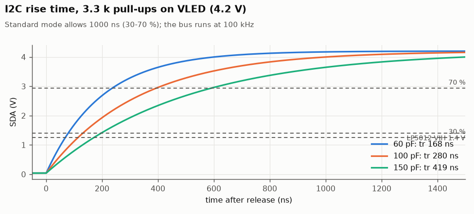

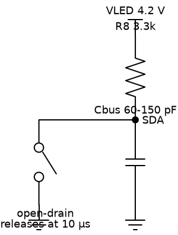

*I²C test circuit: an open-drain pin releases SDA at 10 µs.*

## Model check

Each device model at the operating points it was fitted to (`sim/cases/model_check.cir`).

| Quantity | Model | Datasheet / design | Source |
|---|---|---|---|
| DMG2305UX R_DS(on) @ VGS -4.5 V (Ohm) | 0.040 | 0.040 typ / 0.052 max | KEYSPECS |
| DMG2305UX R_DS(on) @ VGS -2.5 V (Ohm) | 0.084 | 0.052 typ / 0.100 max | KEYSPECS |
| DMG2305UX body diode @ 0.1 A (V) | 0.653 | ~0.65 (PROVISIONAL) | typical silicon |
| Thrive 2835 white VF @ 10 mA (V) | 2.701 | ~2.70 | DS312 Fig. 9 |
| Thrive 2835 white VF @ 25 mA (V) | 2.775 | ~2.75 | DS312 Fig. 9 |
| Thrive 2835 white VF @ 50 mA (V) | 2.851 | ~2.85 | DS312 Fig. 9 |
| Thrive white max-VF die @ 25 mA (V) | 2.925 | ~2.92 | electronics.md 2 |
| Wurth red VF @ 20 mA (V) | 2.001 | 2.0 typ | Wurth p2 |
| Wurth red max die @ 20 mA (V) | 2.401 | 2.4 max | Wurth p2 |
| Wurth green/blue VF @ 20 mA (V) | 3.201 | 3.2 typ | Wurth p2 |
| Wurth green/blue max die @ 20 mA (V) | 3.602 | 3.6 max | Wurth p2 |
| Wurth G/B VF rise 20 -> 25 mA (V) | 0.090 | ~+0.09 | Wurth p3 |
| S1J VF @ 0.2 A (V) | 0.855 | ~0.85 | PLAN / Vishay curve |
| S1J VF @ 1 A (V) | 0.954 | ~0.95 typ (1.1 max) | Vishay |
| LP5012 sink current at VSAT (fraction of ISET) | 0.950 | 0.95 (definition of VSAT) | SLVSEH2B |

## Assumptions (PROVISIONAL until measured)

| Value | Used | Replaced by |
|---|---|---|
| Cell open-circuit voltage vs charge | generic LiCoO2 pouch curve (3.0-4.18 V) | a discharge log of the received cell (bench supply as a load, or F4's run) |
| Cell + PCM resistance | 0.20 Ω; lead 150 nH | the cell's voltage step at a known load |
| Cell PCM over-current trip | ~3 A (DW01-class) | the cell supplier's data |
| 10 µF 0805 16 V DC bias | 6.3 µF at 4.2 V | VERIFY E5 |
| 1 µF 0402 / 0603 DC bias | 0.56 / 0.72 µF at 4.2 V | manufacturer curves |
| DMG2305UX Crss and body diode | 100 pF; 0.65 V at 0.1 A | datasheet curves |
| LP5012 VSAT at 25 mA | 0.30 V typ, 0.45 V max | VERIFY E9 |
| LED forward voltage bins | typical and maximum dies | VERIFY E9 (received dies) |
| LP5012 + MCP9800 supply | 6.8 mA active, 10 µA standby | VERIFY E7 |
| MCU supply | 2.5 mA | VERIFY E3 |
| Neck cable | 63 mΩ and 75 nH per conductor | a 4-wire resistance measurement |
| USB cable | 0.1-0.3 Ω, 1 µH | the charger and cable in use |
| VSYS bulk option | 47 µF, 0.1 Ω ESR | the part chosen, if any |

## Not simulated

- Thermal behaviour: the firmware's 45-58 °C derating, the MCP9800 thermostat and F1's trip are thermal (seconds to minutes) and need the T-series bench tests.
- The MCP73831's control loop, thermal regulation, precharge timer and termination logic (behavioural CC/CV only).
- The ATtiny's BOD response time and the LP5012's start-up sequence (UVLO only).
- ESD on USB-C and the buttons, and the TVS's dynamic resistance beyond its datasheet clamp point.
- Whether the LP5012 staggers its PWM edges (the ripple case assumes it does not).
- Layout parasitics: copper resistance and inductance on both boards are not included.

## Reproduce

```
python3 sim/run_sims.py      # ngspice 42, numpy, matplotlib, schemdraw; ~30 s
```

Netlists as run, ngspice logs and raw waveforms land in `sim/out/<case>/<variant>/`. To test a design change, edit `sim/boards.inc` (or add a variant in `sim/run_sims.py`) and re-run; replace PROVISIONAL values in `sim/models.inc` as bench measurements come in.

## Appendix: board schematics (reference)

Exported from the generated KiCad schematics for comparison with the simulated circuits above.

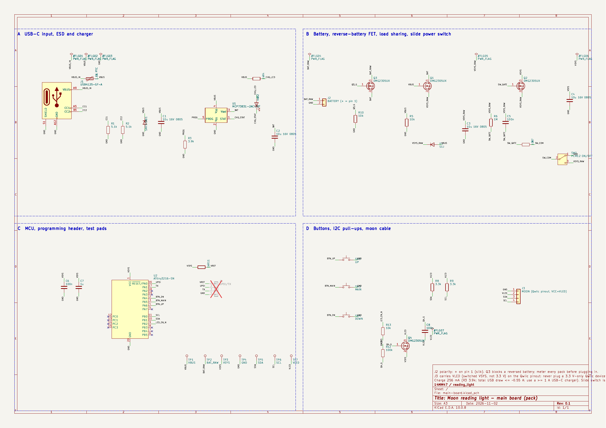

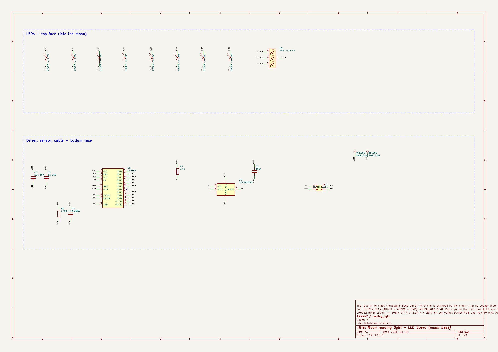
